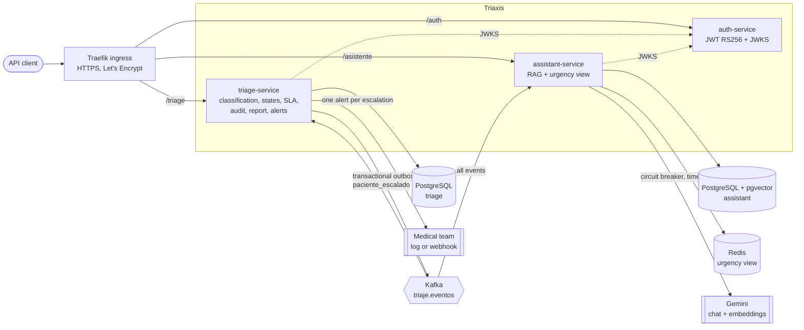

# Triaxis

Reactive digital triage system with a clinical assistant, built with Spring Boot, Kafka and Gemini.

> **Resumen:** Triaxis es un sistema de triaje digital con un asistente clínico, compuesto por servicios de triaje, asistente y autenticación, desarrollados con Spring Boot reactivo, Kafka, PostgreSQL y Redis.

**Deployed on Azure:** https://triaxis-demo.eastus2.cloudapp.azure.com (see [Deployment](#deployment); the credentials of the deployed users are handed over separately).

## Architecture

Three reactive Spring Boot services in a hexagonal layout (ADR 0016), connected only through Kafka and JWT:



- **triage-service** registers and classifies patients (RN-01), runs the state flow (RF-02), escalates overdue patients with one atomic SQL statement (RF-03, RN-03, ADR 0006) and writes the audit trail (RN-04). The patient row, its audit entry and its event are written in one transaction, and a relay publishes the events to Kafka in order (transactional outbox, ADR 0005). A Kafka listener sends the alerts of RF-06.
- **assistant-service** answers questions with RAG over the protocols (pgvector through R2DBC) and validates every citation (RF-04, RN-05, ADR 0007). It builds the urgency view in Redis only from the Kafka events, never by calling triage.
- **auth-service** issues RS256 tokens and publishes the JWKS. It is a third service so the two business services only validate tokens (ADR 0003).
- **Triage never depends on the assistant**, and the urgency view keeps working when Gemini is down. Each service owns its database.
- **Inside each service:** `domain` (rules, JDK only), `application` (use cases and ports) and `infrastructure` (web, persistence, Kafka, LLM and Redis adapters). ArchUnit tests enforce the direction of the dependencies.

The full design is in [docs/ARCHITECTURE.md](docs/ARCHITECTURE.md) (data model, SQL, event contract, configuration and security).

## Tech stack

| Area | Choice |
|---|---|
| Language and framework | Java 21, Spring Boot 3.5.16, Spring WebFlux with Project Reactor |
| Persistence | R2DBC with PostgreSQL 16; pgvector 0.8.7 for the protocol embeddings |
| Messaging | Apache Kafka 3.9.1 (KRaft) with Spring Kafka; JSON events with a version field |
| Read model | Redis 7.4 for the urgency view |
| AI | Spring AI 1.1.8 with Gemini (`gemini-2.5-flash`, `gemini-embedding-001`); a deterministic `mock` provider for local runs and tests |
| Resilience | Resilience4j 2.4.0: a circuit breaker, a timeout and the 503 fallback on the LLM |
| Security | JWT RS256 with JWKS, Spring Security resource servers, BCrypt |
| Observability | Micrometer with Prometheus, OpenTelemetry traces, ECS JSON logs |
| Tests | JUnit 5, Testcontainers (PostgreSQL, Kafka, Redis), BlockHound, ArchUnit, JaCoCo |
| Deployment | Docker, Kubernetes with Kustomize, Traefik 3.7, Terraform (azurerm 4.81) on AKS |

Versions and naming rules are in [docs/TECH_STACK.md](docs/TECH_STACK.md).

## Requirements map

| Requirement | Where |
|---|---|
| RF-01 registration and classification | `POST /triage/pacientes`; `TriageClassifier` (domain), validation in the domain (ADR 0017) |
| RF-02 state flow | `PATCH /triage/pacientes/{id}/estado` with a conditional `UPDATE`; `GET /triage/pacientes/{id}` |
| RF-03 SLA and escalation | `EscalationScheduler`; interval and SLA in `triage.escalation.*` and `triage.sla.minutes.*` |
| RF-04 assistant | `POST /asistente/consulta` (RAG, citations); `GET /asistente/estado-urgencias` (Kafka to Redis) |
| RF-05 operation report | `GET /triage/reportes/operacion`: one SQL query with window functions and `percentile_cont` |
| RF-06 alerts | Kafka listener with a log or webhook channel (ADR 0011, ADR 0023) |
| RN-04 audit | append-only `patient_audit`, protected by triggers, no delete endpoint (ADR 0014) |
| RN-05 anti-hallucination | retrieval gate, constrained prompt and validated citations (ADR 0007) |

## How to run

Requirement: Docker. One command builds the images and starts PostgreSQL, Kafka, Redis, Jaeger and the three services (verified):

```bash
docker compose up --build
```

The services answer on `localhost:8083` (auth), `8081` (triage) and `8082` (assistant); every port is published on `127.0.0.1` only. Stop with `docker compose down` (add `-v` to delete the data).

For development with Gradle (JDK 21), start only the infrastructure and run the services from Gradle:

```bash
docker compose up -d postgres kafka kafka-init redis jaeger

# in separate terminals (JAVA_HOME must point to a JDK 21)
./gradlew :triaxis-auth-service:bootRun --args='--spring.profiles.active=local'
./gradlew :triaxis-triage-service:bootRun --args='--spring.profiles.active=local'
./gradlew :triaxis-assistant-service:bootRun --args='--spring.profiles.active=local'   # mock provider, no key
```

The assistant answers with the deterministic `mock` provider by default. To use Gemini, export `GEMINI_API_KEY` (never commit it) and add the `gemini` profile: `--spring.profiles.active=local,gemini`.

Local demonstration users (profile `local` only): `nurse` / `nurse-demo` and `doctor` / `doctor-demo`.

```bash
TOKEN=$(curl -s -X POST localhost:8083/auth/token -H 'Content-Type: application/json' \
  -d '{"username":"nurse","password":"nurse-demo"}' | jq -r .access_token)

curl -s -X POST localhost:8081/triage/pacientes -H "Authorization: Bearer $TOKEN" \
  -H 'Content-Type: application/json' \
  -d '{"nombreCompleto":"Ana Gomez","edad":54,"frecuenciaCardiaca":130,"presionSistolica":180,"presionDiastolica":110,"spo2":97,"temperatura":36.8,"dolor":8,"gcs":15,"quejaPrincipal":"Dolor torácico"}'
```

### Escalation

Patients who exceed the SLA of their level are escalated automatically: every 30 seconds (`triage.escalation.interval`) a single atomic statement flags them (`escalado: true`), writes an audit entry by `system` and publishes `paciente_escalado`. The status does not change, and a patient is escalated at most once. To see it quickly, start triage with a short SLA (verified):

```bash
./gradlew :triaxis-triage-service:bootRun --args='--spring.profiles.active=local --triage.sla.minutes.CRITICAL=1 --triage.escalation.interval=PT5S'
```

### Alerts

When a patient is escalated, the medical team gets one alert (RF-06, ADR 0011). A listener in its own Kafka group reads `paciente_escalado` and sends the minimum: the level, the minutes waited, the SLA and the path `/triage/pacientes/{id}`, without name, vital signs or complaint. An event is alerted at most once, and a patient who is already in consultation or discharged when the event is handled is not alerted (ADR 0023). A failing channel is tried 3 times and never affects the escalation.

- **Log channel (default):** one `WARN` line of the logger `dev.triaxis.triage.alerts`.
- **Webhook channel:** a JSON POST with a `text` field (shown by Slack and Teams incoming webhooks) and the structured fields. The URL is a secret and comes only from the environment (verified with a local receiver):

```bash
ALERT_WEBHOOK_URL=http://127.0.0.1:9099/hook ./gradlew :triaxis-triage-service:bootRun \
  --args='--spring.profiles.active=local --triage.alerts.channel=webhook --triage.sla.minutes.CRITICAL=1 --triage.escalation.interval=PT5S'
```

The metric `triage_alerts_total` counts the outcomes (`sent`, `failed`, `skipped`, `duplicate`).

### Errors

Every error of every service has the same shape (RFC 7807): `type`, `title`, `status`, `detail`, `instance`, `traceId` and `timestamp`. Validation errors add `errores`, a list of `campo` and `mensaje`.

### Observability

- **Logs:** JSON (ECS) on standard output, with `traceId` and `spanId`; the `local` profile prints plain text. One access-log line per request (never bodies or tokens).
- **Traces:** OpenTelemetry. Start a service with `TRACING_EXPORT_ENABLED=true` and open Jaeger at http://localhost:16686. Send a `traceparent` header to continue an existing trace.
- **Metrics:** `curl -u metrics:metrics-local localhost:8081/actuator/prometheus` (local profile password; elsewhere `METRICS_USER` and `METRICS_PASSWORD`, otherwise the endpoint is denied).
- **Health:** `/actuator/health/liveness` and `/actuator/health/readiness`.

### Configuration

Everything is configured through environment variables; nothing secret is in the repository. The table is in [docs/ARCHITECTURE.md](docs/ARCHITECTURE.md) section 10.

## API overview

| Service | Endpoint | Role |
|---|---|---|
| auth (8083) | `POST /auth/token`, `GET /.well-known/jwks.json` | public |
| triage (8081) | `POST /triage/pacientes` | `NURSE` |
| triage (8081) | `PATCH /triage/pacientes/{id}/estado` | `NURSE`, `DOCTOR` |
| triage (8081) | `GET /triage/pacientes/{id}` | `NURSE`, `DOCTOR` |
| triage (8081) | `GET /triage/reportes/operacion?desde=2026-11-19&hasta=2026-11-19`: patients, levels and waits (average and p95) per UTC hour; dates or instants with a zone, at most 31 days | `DOCTOR` |
| assistant (8082) | `POST /asistente/consulta` with `{ "pregunta": "..." }` | `DOCTOR` |
| assistant (8082) | `GET /asistente/estado-urgencias`: active patients per level, built only from the Kafka events | `NURSE`, `DOCTOR` |

The assistant answers only from the clinical protocols, with the cited `fuentes` taken from the corpus. When no protocol applies it answers `No existe un protocolo disponible para esta pregunta.` with empty `fuentes`, and when the language model is unavailable it answers 503 (ADRs 0004 and 0007).

```bash
TOKEN=$(curl -s -X POST localhost:8083/auth/token -H 'Content-Type: application/json' \
  -d '{"username":"doctor","password":"doctor-demo"}' | jq -r .access_token)
curl -s -X POST localhost:8082/asistente/consulta -H "Authorization: Bearer $TOKEN" \
  -H 'Content-Type: application/json' -d '{"pregunta":"¿Cuándo se administra el primer antibiótico en sepsis?"}'
```

Security is deny-by-default: every route has an explicit role rule, so a path without one answers 401 without a token and 403 with one. Tokens are RS256 JWTs from the auth service and must carry `iss`, `aud` and `exp`.

The alerts add no endpoint: they are sent from Kafka events. Assumptions and ambiguities of the specification are in [docs/ASSUMPTIONS.md](docs/ASSUMPTIONS.md).

## Decisions

The 24 decision records are in [docs/adr/](docs/adr/) (index in its README). The key ones:

| Decision | Why |
|---|---|
| Hexagonal architecture per service ([0016](docs/adr/0016-hexagonal-architecture.md)) | The clinical rules stay pure and testable without Spring; adapters can change without touching them |
| Transactional outbox ([0005](docs/adr/0005-transactional-outbox.md)) | A patient change and its event are never out of sync, even if Kafka is down |
| Atomic escalation with `FOR UPDATE SKIP LOCKED` ([0006](docs/adr/0006-atomic-escalation.md)) | Escalation is idempotent (RN-03) and safe with several replicas, in one statement |
| Spring Kafka instead of Reactor Kafka ([0001](docs/adr/0001-spring-kafka-instead-of-reactor-kafka.md)) | Maintained, with acknowledgment after handling; the reactive code bridges with bounded concurrency |
| Vectors in pgvector through R2DBC ([0002](docs/adr/0002-vectors-over-r2dbc.md)) | No blocking JDBC driver and no extra database; the corpus lives next to the data it describes |
| Anti-hallucination in layers ([0007](docs/adr/0007-anti-hallucination.md)) | The gate, the prompt and the citation check each stop invented content alone |
| Degraded mode ([0004](docs/adr/0004-degraded-mode.md)) | A failing LLM gives a clear 503 quickly instead of hanging; the rest keeps working |
| Gemini with a `mock` provider ([0008](docs/adr/0008-gemini-and-mock-provider.md)) | Real RAG in Azure; tests and local runs need no key and are deterministic |
| Own identity service with RS256 and JWKS ([0003](docs/adr/0003-identity-service-rs256-jwks.md)) | The business services only validate tokens; a managed provider could replace it |
| Alerts from Kafka, only while the patient waits ([0011](docs/adr/0011-alert-channel.md), [0023](docs/adr/0023-alerts-only-for-waiting-patients.md)) | The open RF-06: one alert per escalation, never from the escalation transaction, without clinical data |
| AKS with one node and Terraform ([0010](docs/adr/0010-deployment-on-aks.md)) | Kubernetes manifests as asked, with the state in the cluster to keep the cost of a demonstration low |

Every ambiguity of the specification is resolved in [docs/ASSUMPTIONS.md](docs/ASSUMPTIONS.md) with its decision, the reason and the impact if it were wrong (for example integer vital signs, the exact match of administrative complaints, the meaning of "exceeded the SLA" and the waiting time of a patient discharged directly).

## Testing

```bash
./gradlew build      # compiles and runs every test of the six modules; needs JDK 21 and Docker (Testcontainers)
```

Result of the last run (verified): **533 tests, all passing.**

| Module | Tests | Line coverage | Branch coverage |
|---|---|---|---|
| triage-service | 310 | 94 % | 75 % |
| assistant-service | 131 | 95 % | 83 % |
| auth-service | 35 | 97 % | 84 % |
| security (library) | 26 | 95 % | 79 % |
| web (library) | 22 | 94 % | 77 % |
| common (event contract) | 9 | n/a (records only) | n/a |

What the tests cover, as the specification asks:

- **Classification:** the reference patients E1 to E6, the limits of every level and the administrative complaints (domain unit tests, and the API with the same cases).
- **State flow:** every valid and invalid transition, 404 and 409, and two concurrent changes of the same patient (one wins).
- **Escalation:** idempotency (a second run does nothing), patients in consultation or discharged are never escalated, the event and the audit entry, and several schedulers in parallel.
- **RAG:** the three sample questions with their citations, the "no match without hallucination" case (the LLM is not called), invalid or unretrieved citations rejected, and the 503 of the degraded mode.
- **Integration:** PostgreSQL, Kafka and Redis in Testcontainers (the outbox relay, the urgency view from real events, the report SQL, the alert listener). The LLM is always the mock or a stub, never a real call.
- **Guards:** BlockHound fails any blocking call on a reactive thread; ArchUnit checks the layers; a route test checks that every endpoint has its role rule.

Coverage reports (JaCoCo) are written to `<module>/build/reports/jacoco/test/html/index.html`.

## Deployment

Kubernetes manifests (Kustomize) are in [`deploy/k8s`](deploy/k8s): a base and the overlays `kind` (local validation) and `aks` (Azure). The decisions are in [ADR 0010](docs/adr/0010-deployment-on-aks.md).

- **One node, everything inside:** the three services, PostgreSQL with pgvector, Kafka (KRaft) and Redis, with persistent volumes; Traefik is the ingress controller, with the paths `/auth`, `/.well-known/jwks.json`, `/triage` and `/asistente`. `/actuator` is not routed.
- **Security:** the pods run without root, with a read-only file system; the Secret is created by `deploy/scripts/create-secrets.sh` from generated values and local files (never from the repository).

**Local cluster (kind, verified):**

```bash
deploy/scripts/kind-up.sh          # builds the images, creates the cluster, the Secret and the workloads
# the Ingress answers on http://localhost:8088, for example:
curl -s -X POST localhost:8088/auth/token -H 'Content-Type: application/json' \
  -d '{"username":"nurse","password":"nurse-demo"}'
kind delete cluster --name triaxis
```

**Azure (AKS):** deployed at https://triaxis-demo.eastus2.cloudapp.azure.com (verified on 2026-11-20 with the sample flow over HTTPS and a question to Gemini; the credentials of the deployed users are handed over separately, the demo passwords are refused there). [Terraform](deploy/azure/terraform) creates the resource group, an AKS cluster with the free tier and one `Standard_D2as_v7` node (2 vCPU, 8 GiB) in `eastus2`, the static public IP with its DNS label, and an optional budget. Traefik gets a Let's Encrypt certificate for that host and redirects HTTP to HTTPS; the assistant uses Gemini with the key from the Secret.

```bash
cp deploy/azure/terraform/terraform.tfvars.example deploy/azure/terraform/terraform.tfvars   # set subscription_id
deploy/azure/deploy.sh     # images to GHCR (they must be public), terraform plan, confirm, apply that plan, Secret, aks overlay, wait for HTTPS
deploy/azure/stop.sh       # stop the node between demonstrations; start.sh starts it again and waits for HTTPS
deploy/azure/destroy.sh    # delete everything (asks first; --yes skips the question, also for deploy.sh)
```

The scripts read local files outside the repository: `~/.config/triaxis/ghcr.env` (a GitHub token that can publish packages), `deploy.env` (the passwords of the deployed users) and `gemini.env`.

## Author

- Name: Jaider Betancur Torres
- LinkedIn: [jaiderbt](https://www.linkedin.com/in/jaiderbt/)
- GitHub: [Jaiderin123](https://github.com/Jaiderin123)
- Portfolio: [jaiderin123.github.io/portfolio](https://jaiderin123.github.io/portfolio)
