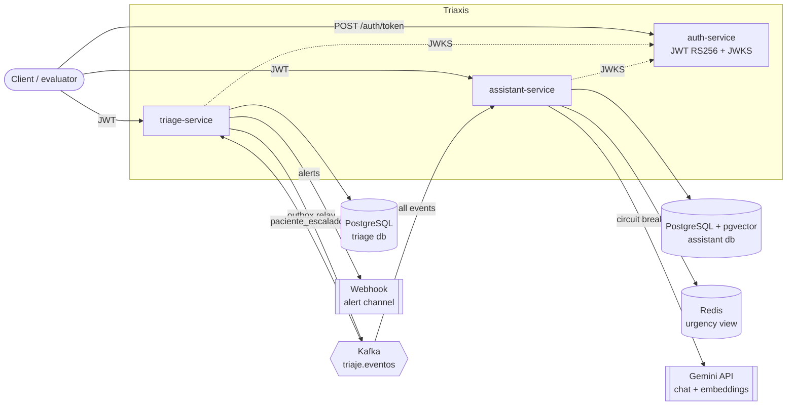
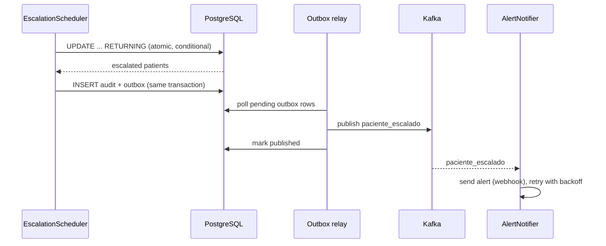
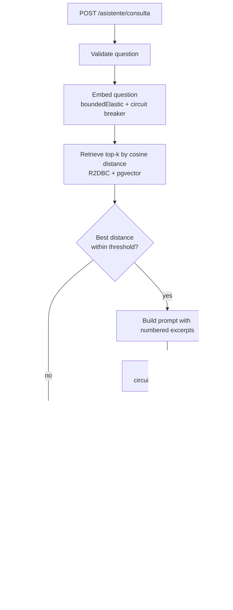

# Triaxis: Architecture

Architecture and design decisions for **Triaxis**, a digital triage system with a clinical assistant.
Companion documents: [`TECH_STACK.md`](TECH_STACK.md) (stack and versions) and [`adr/`](adr/) (decision records).

Status: **proposal**, to be refined while implementing. Items under "Open decisions" can still change.

---

## 1. Scope and goals

Triaxis replaces a manual triage process (a nurse writes a priority level on paper) with:

1. **Triage service**: registers patients with vital signs, classifies them automatically, controls their clinical state, watches waiting-time SLAs, escalates overdue patients automatically, and keeps a complete audit trail.
2. **Clinical Assistant service**: lets doctors query internal clinical protocols in natural language (RAG). It must never invent clinical content: every answer is backed by the official corpus and cites its source.
3. **Auth service**: issues JWTs so the other two services can authorize requests without sharing secrets.

Non-functional goals: non-blocking reactive code (no blocking calls on the event loop), asynchronous integration through Kafka, resilience when the LLM provider fails, observability, and one-command local execution.

Backend only. No frontend.

---

## 2. Requirements traceability

| Requirement | Where it is handled |
|---|---|
| RF-01 Register and classify patients | `triage-service`: `RegisterPatientUseCase`, `TriageClassifier` (pure domain logic) |
| RF-02 Clinical state flow | `triage-service`: `PatientStatus` transition policy, conditional `UPDATE` |
| RF-03 SLA monitoring and escalation | `triage-service`: `EscalationScheduler` + atomic `UPDATE ... RETURNING` |
| RF-04 A Clinical assistant (RAG) | `assistant-service`: `AskClinicalQuestionUseCase` |
| RF-04 B Real-time urgency state | `assistant-service`: Kafka consumer + Redis read model |
| RF-05 Operation report | `triage-service`: advanced SQL (window functions, `FILTER`, percentile) |
| RF-06 Escalation alerts (open) | `triage-service`: Kafka-driven `AlertNotifier` (see 6.8 and ADR) |
| RN-01 Classification by level | `TriageClassifier` |
| RN-02 SLA per level | `SlaPolicy` (configurable) |
| RN-03 Escalation idempotency | Conditional `UPDATE`, `FOR UPDATE SKIP LOCKED` |
| RN-04 Clinical audit | `patient_audit` table with the actor, append-only, no delete endpoint (ADR 0014) |
| RN-05 Anti-hallucination | Retrieval threshold + validated citations (see 7.2) |
| Resilience4j on the LLM | `assistant-service`: circuit breaker, timeout, 503 fallback |
| Observability | Actuator probes, Micrometer metrics, structured logs with correlation id |
| Security | JWT (RS256) from `auth-service`, resource server in the other two |

---

## 3. System overview



Key properties:

- **Triage never depends on the assistant.** The only link between them is the Kafka topic, and it goes from Triage to Assistant.
- **The urgency view does not depend on the LLM.** If Gemini is down, `GET /asistente/estado-urgencias` still works.
- **Each service owns its database** (separate databases in the same PostgreSQL server).

---

## 4. Services

| Service | Port | Datastores | Base path |
|---|---|---|---|
| `triaxis-triage-service` | 8081 | PostgreSQL (`triage`), Kafka producer and consumer (alerts) | `/triage/**` |
| `triaxis-assistant-service` | 8082 | PostgreSQL + pgvector (`assistant`), Redis, Kafka consumer | `/asistente/**` |
| `triaxis-auth-service` | 8083 | None (in-memory users from configuration) | `/auth/**`, `/.well-known/jwks.json` |
| `triaxis-common` | n/a | Library: event contract records | n/a |
| `triaxis-security` | n/a | Library: shared resource-server configuration | n/a |

Path-based routing works behind a single Ingress without rewrites, because each service already owns a distinct base path.

---

## 5. Architectural style

**Hexagonal architecture (ports and adapters)** in each service. The domain does not know Spring, R2DBC, Kafka or the LLM provider.

```
dev.triaxis.<service>
├── domain
│   ├── model            entities, value objects, enums
│   ├── service          pure domain logic (classifier, policies)
│   └── exception
├── application
│   ├── port.in          use cases (interfaces)
│   ├── port.out         repositories, publishers, LLM, clock (interfaces)
│   └── service          use case implementations
├── infrastructure
│   ├── adapter.in       web (functional endpoints, see 5.1), scheduler, Kafka listeners
│   ├── adapter.out      persistence (R2DBC), messaging, LLM, Redis
│   └── config           Spring configuration, properties
└── <Service>Application
```

Rules:

1. `domain` depends on nothing but the JDK.
2. `application` depends on `domain` only.
3. `infrastructure` depends on both; nothing depends on `infrastructure`.
4. The external contract (Spanish names, JSON shape) is mapped at the boundary (DTOs and mappers). The domain uses English names.
5. Boundaries are enforced with **ArchUnit** tests.
6. Time always comes from a `Clock` port (UTC), so SLA logic is testable without sleeping.

### 5.1 Web layer: functional endpoints

The web adapters use **WebFlux functional endpoints** (`RouterFunction` and `HandlerFunction`) instead of `@RestController`. A router declares the routes, a handler contains one method per route, and both are plain adapters that call a use case.

Detailed layout of `triage-service` (the other services follow the same shape):

```
dev.triaxis.triage
├── domain
│   ├── model            Patient, VitalSigns, TriageLevel, PatientStatus, AuditEntry, DomainEvent
│   ├── rule             TriageLevelRule (interface) + one class per level   (Strategy)
│   ├── service          TriageClassifier, SlaPolicy, StatusTransitionPolicy
│   └── exception
├── application
│   ├── port.in          RegisterPatientUseCase, ChangePatientStatusUseCase, GetPatientUseCase,
│   │                    EscalateOverduePatientsUseCase, GetOperationReportUseCase
│   ├── port.out         PatientRepository, AuditRepository, EventPublisher,
│   │                    ReportQuery, AlertNotifier, ClockPort
│   └── service          use case implementations
├── infrastructure
│   ├── adapter.in
│   │   ├── web
│   │   │   ├── router       PatientRouter, ReportRouter           (RouterFunction beans)
│   │   │   ├── handler      PatientHandler, ReportHandler
│   │   │   ├── dto          request and response records (Spanish external names)
│   │   │   ├── mapper       MapStruct: DTO <-> command and domain <-> response
│   │   │   ├── validation   RequestValidator
│   │   │   └── error        GlobalErrorHandler (WebExceptionHandler)
│   │   ├── scheduler        EscalationScheduler
│   │   └── messaging        EscalationAlertListener
│   ├── adapter.out
│   │   ├── persistence      entity, R2DBC repositories, repository adapters, report query
│   │   ├── messaging        OutboxEventPublisher, OutboxRelay
│   │   └── alert            WebhookAlertNotifier, LoggingAlertNotifier
│   └── config               Spring configuration, properties
└── TriageApplication
```

Consequences of using functional endpoints (and how each is handled):

| Topic | With `@RestController` | With functional endpoints (this project) |
|---|---|---|
| Bean validation | `@Valid` on the body | Handler calls `RequestValidator` (Spring `Validator`), which collects violations and throws a validation exception naming the field |
| Error handling | `@RestControllerAdvice` | `@RestControllerAdvice` does **not** apply; a `WebExceptionHandler` maps exceptions to `ProblemDetail` |
| Authorization | Often `@PreAuthorize` | Path and method rules in `SecurityWebFilterChain` (for example `POST /triage/pacientes` requires `NURSE`) |
| OpenAPI | Automatic | Not automatic; keep a hand-written `openapi.yaml` or add springdoc router annotations (optional) |
| Controller tests | `@WebFluxTest` | `WebTestClient.bindToRouterFunction(router)` |

### 5.2 SOLID and design patterns

Where each principle shows up:

| Principle | Where |
|---|---|
| **S**ingle responsibility | Handler translates HTTP, use case orchestrates, domain decides, adapter does I/O. Each class has one reason to change |
| **O**pen/closed | A new classification rule, alert channel or LLM provider is a new class; existing ones are not modified |
| **L**iskov substitution | `LlmPort` (Gemini or mock) and `AlertNotifier` (webhook or log) implementations are interchangeable without the caller noticing |
| **I**nterface segregation | Small ports: `PatientRepository`, `AuditRepository`, `ReportQuery` and `EventPublisher` are separate instead of one large repository |
| **D**ependency inversion | `application` depends on `port.out` interfaces; `infrastructure` implements them; Spring wiring lives in `config` |

Patterns and their location (used only where they solve a real problem):

| Pattern | Where | Purpose |
|---|---|---|
| Ports and adapters | `application/port`, `infrastructure/adapter` | Isolate the domain from frameworks |
| Strategy (ordered list of rules) | `domain/rule` | One `TriageLevelRule` per level; the classifier evaluates them from most to least severe |
| Enum-based state machine | `domain/model/PatientStatus` | Allowed transitions live next to the states |
| Static factory | `Patient.register(...)`, event factory | Create entities in a valid state |
| Repository | `port.out` plus R2DBC adapters | Persistence abstraction |
| Decorator | `ResilientClinicalAnswerGenerator` wraps the Spring AI adapter with circuit breaker and timeout | Resilience without polluting the adapter, explicit and testable instead of annotations |
| Anti-corruption layer / Mapper | `adapter.in.web.mapper`, persistence mappers | External contract (Spanish) and storage never leak into the domain |
| Transactional outbox | `adapter.out.messaging` | Reliable event publication |
| Null object | `LoggingAlertNotifier` as the default notifier | The system works without an external webhook |
| Builder | Response and prompt construction | Readable construction of complex objects |
| Domain events | Use cases emit events through `EventPublisher` | Decouple state changes from their consequences |

Guideline: no pattern is added only to name it. If a class would have a single implementation and no seam is needed, keep it simple.

Reactive rules:

- No blocking call on an event-loop thread. Blocking SDK calls (`EmbeddingModel`, blocking client code) run on `Schedulers.boundedElastic()`.
- Optional but valuable: BlockHound in tests to prove nothing blocks.
- Bounded concurrency everywhere (`flatMap(..., concurrency)`), explicit timeouts on all remote calls.

---

## 6. Triage service

### 6.1 Domain

- `Patient` (id, full name, age, `VitalSigns`, chief complaint, level, SLA minutes, status, escalated flag, timestamps).
- `VitalSigns`: heart rate, systolic, diastolic, SpO2, temperature, pain, GCS.
- `TriageLevel`: `CRITICAL`, `URGENT`, `URGENT_2`, `NOT_URGENT`, `NOT_URGENT_2`, each mapped to its external value (`CRITICO`, `URGENTE`, `URGENTE_2`, `NO_URGENTE`, `NO_URGENTE_2`).
- `PatientStatus`: `REGISTERED`, `IN_CONSULTATION`, `DISCHARGED` (external `REGISTRADO`, `EN_CONSULTA`, `ALTA`).

### 6.2 Classification (RN-01)

`TriageClassifier` is a pure function: vital signs plus complaint in, level out. Conditions are evaluated from the most severe level downward, and the first match wins.

| Level | Condition (any) |
|---|---|
| 1 CRITICAL | HR < 40 or HR > 120, SpO2 < 90, systolic < 90, GCS <= 8 |
| 2 URGENT | 90 <= SpO2 <= 93, 90 <= systolic <= 100, temp >= 38.5, 9 <= GCS <= 13 |
| 3 URGENT_2 | 90 <= HR <= 120, 38.0 <= temp < 38.5, pain >= 7 |
| 4 NOT_URGENT | none of the above |
| 5 NOT_URGENT_2 | level 4 **and** complaint is administrative |

Assumptions (also recorded in the README):

- **A1.** HR, systolic, diastolic, SpO2, pain, GCS and age are integers. Decimals are rejected with 400. This removes the gap between 93 and 94 for SpO2. Temperature has one decimal.
- **A2.** GCS 14 and 15 do not trigger any level by themselves.
- **A3.** The administrative complaint list (`documentos`, `recoleccion de resultados`, `renovacion de recetario`, `vacunacion`, `seguimiento`) is configurable. Matching uses **normalized exact equality** (lowercase, accents removed, trimmed), not "contains", so a clinical complaint that merely mentions "seguimiento" is not downgraded.
- **A4.** Validation ranges follow the specification table (HR 20-250, systolic 60-260, diastolic 30-160 and lower than systolic, SpO2 70-100, temp 34.0-42.0, pain 0-10, GCS 3-15, age 0-120, name 3-100 characters). The error message names the invalid field.

Reference cases E1 to E6 become unit tests.

### 6.3 State machine (RF-02)

```
REGISTERED ──► IN_CONSULTATION ──► DISCHARGED
     └───────────────────────────────►┘
```

Any other transition (including same state) returns **409** with a descriptive message. Unknown patient returns **404**. An escalated patient can still move to `IN_CONSULTATION`; the flag stays.

The change is a conditional update, so concurrent requests cannot both succeed:

```sql
UPDATE patients
SET status = :new,
    status_changed_at = :now,
    consultation_started_at = CASE WHEN :new = 'IN_CONSULTATION' THEN :now ELSE consultation_started_at END
WHERE id = :id AND status = :expected
RETURNING *;
```

Zero rows returned means: re-read the patient, then 404 (missing) or 409 (state changed or invalid).

### 6.4 Persistence

```sql
CREATE TABLE patients (
  id                      UUID PRIMARY KEY,
  full_name               VARCHAR(100) NOT NULL,
  age                     SMALLINT NOT NULL,
  heart_rate              SMALLINT NOT NULL,
  systolic                SMALLINT NOT NULL,
  diastolic               SMALLINT NOT NULL,
  spo2                    SMALLINT NOT NULL,
  temperature             NUMERIC(3,1) NOT NULL,
  pain                    SMALLINT NOT NULL,
  gcs                     SMALLINT NOT NULL,
  chief_complaint         TEXT NOT NULL,
  level                   VARCHAR(16) NOT NULL,
  sla_minutes             INTEGER NOT NULL,
  status                  VARCHAR(16) NOT NULL,
  escalated               BOOLEAN NOT NULL DEFAULT FALSE,
  escalated_at            TIMESTAMPTZ,
  registered_at           TIMESTAMPTZ NOT NULL,
  status_changed_at       TIMESTAMPTZ NOT NULL,
  consultation_started_at TIMESTAMPTZ
);
CREATE INDEX idx_patients_sla ON patients (status, escalated, registered_at);

CREATE TABLE patient_audit (
  id              BIGSERIAL PRIMARY KEY,
  patient_id      UUID NOT NULL,
  actor           VARCHAR(100) NOT NULL,   -- JWT subject, or 'system' for the scheduler
  event_type      VARCHAR(32) NOT NULL,
  previous_status VARCHAR(16),
  new_status      VARCHAR(16) NOT NULL,
  escalated       BOOLEAN NOT NULL,
  occurred_at     TIMESTAMPTZ NOT NULL
);
-- Append-only: a trigger rejects UPDATE and DELETE; the API exposes no delete endpoint.

CREATE TABLE outbox_events (
  id           BIGSERIAL PRIMARY KEY,
  event_id     UUID NOT NULL UNIQUE,
  message_key  VARCHAR(64) NOT NULL,
  event_type   VARCHAR(32) NOT NULL,
  payload      JSONB NOT NULL,
  created_at   TIMESTAMPTZ NOT NULL,
  published_at TIMESTAMPTZ
);
CREATE INDEX idx_outbox_pending ON outbox_events (id) WHERE published_at IS NULL;
```

The schema is created by initialization scripts executed through R2DBC (no Flyway, to avoid a second JDBC driver). The R2DBC connection uses UTC as session time zone.

### 6.5 Events and the transactional outbox

Every state change writes **patient row, audit entry and outbox row in one transaction** (`TransactionalOperator`). A relay then publishes outbox rows to Kafka:

- Polls `WHERE published_at IS NULL ORDER BY id LIMIT n FOR UPDATE SKIP LOCKED`, sends, then marks as published.
- Single relay in flight (advisory lock) to preserve per-patient ordering.
- Producer: `acks=all`, idempotence enabled, key = patient id (ordering per patient within a partition).
- Delivery is **at least once**; consumers are idempotent.

Why: publishing to Kafka directly after the database commit can lose the event (or the other way around). The outbox removes that dual-write problem.

> **Fallback if time is short:** publish after commit with retry, and document the trade-off in the ADR. The outbox is the first item to cut.

### 6.6 Escalation (RF-03, RN-03)

A scheduler runs every `triage.escalation.interval` (configurable) and escalates in **one atomic statement**:

```sql
WITH overdue AS (
  SELECT id FROM patients
  WHERE status = 'REGISTERED'
    AND NOT escalated
    AND registered_at + make_interval(mins => sla_minutes) < :now
  ORDER BY registered_at
  LIMIT :batch
  FOR UPDATE SKIP LOCKED
)
UPDATE patients p
SET escalated = TRUE, escalated_at = :now
FROM overdue o
WHERE p.id = o.id
RETURNING p.id, p.level, p.sla_minutes, p.registered_at;
```

For each returned row, in the same transaction: insert the audit entry and the outbox row (`paciente_escalado`).

Why this satisfies RN-03:

- The `WHERE` makes a second attempt a no-op (already escalated, or no longer `REGISTERED`), so there is no duplicate event or audit row.
- A patient who entered consultation or was discharged is never selected.
- `SKIP LOCKED` makes it safe with several replicas.
- A concurrent `PATCH` to `IN_CONSULTATION` and the scheduler cannot both win, because both are conditional updates.



The interval and the SLA per level are application properties, so tests can use seconds instead of minutes.

### 6.7 Operation report (RF-05)

```sql
WITH hourly AS (
  SELECT date_trunc('hour', registered_at) AS hour,
         count(*)                                         AS total,
         count(*) FILTER (WHERE level = 'CRITICAL')       AS critical,
         count(*) FILTER (WHERE level = 'URGENT')         AS urgent,
         count(*) FILTER (WHERE level = 'URGENT_2')       AS urgent_2,
         count(*) FILTER (WHERE level = 'NOT_URGENT')     AS not_urgent,
         count(*) FILTER (WHERE level = 'NOT_URGENT_2')   AS not_urgent_2,
         avg(extract(epoch FROM consultation_started_at - registered_at) / 60)
             FILTER (WHERE consultation_started_at IS NOT NULL)            AS avg_wait_min,
         percentile_cont(0.95) WITHIN GROUP
             (ORDER BY extract(epoch FROM consultation_started_at - registered_at) / 60)
             FILTER (WHERE consultation_started_at IS NOT NULL)            AS p95_wait_min
  FROM patients
  WHERE registered_at >= :from AND registered_at < :to
  GROUP BY 1
)
SELECT h.*,
       sum(total) OVER (ORDER BY hour)      AS cumulative_total,
       rank()     OVER (ORDER BY total DESC) AS load_rank
FROM hourly h
ORDER BY hour;
```

Assumptions: waiting time is registration to the first (and only) transition into consultation; patients discharged directly have no waiting time and are excluded from the average and p95; hours without patients are omitted.

### 6.8 Alerts to the medical team (RF-06, open requirement)

**Proposal:** a Kafka-driven `AlertNotifier` port inside `triage-service`.

- A separate consumer group subscribes to `triaje.eventos` and reacts to `paciente_escalado`.
- Adapter `WebhookAlertNotifier` posts a small JSON message (compatible with Slack or Teams incoming webhooks) to a configurable URL. Default adapter: structured log, so the system works without any external account.
- Retries with backoff; a failure to notify is counted (metric) and never affects the escalation itself.

Why: alerting is a reaction to a domain event, so it is decoupled from the escalation transaction; it adds no fourth service; and it is testable with a fake webhook.

Alternatives considered (to document in the ADR): email through SMTP (needs infrastructure), Server-Sent Events stream (good demo, but only works within one replica unless fed from Kafka), a dedicated `notification-service` (cleanest separation, but more deployment cost).

### 6.9 API contract

External names are Spanish, as specified.

| Method and path | Role | Success | Errors |
|---|---|---|---|
| `POST /triage/pacientes` | NURSE | 201 with `id`, `nivel`, `slaMinutos`, `estado: "REGISTRADO"`, `fechaRegistro` (ISO 8601) | 400 (invalid field), 401, 403 |
| `PATCH /triage/pacientes/{id}/estado` body `{ "estado": "..." }` | NURSE, DOCTOR | 200 | 400, 404, 409 |
| `GET /triage/pacientes/{id}` | NURSE, DOCTOR | 200: full data, `estado`, flags (`escalado`), time in current state | 404 |
| `GET /triage/reportes/operacion?desde=&hasta=` | DOCTOR | 200: list of hourly buckets | 400 (invalid range) |

Request body fields: `nombreCompleto`, `edad`, `frecuenciaCardiaca`, `presionSistolica`, `presionDiastolica`, `spo2`, `temperatura`, `dolor`, `gcs`, `quejaPrincipal`. Because the exact field names are not given, common variants are accepted with `@JsonAlias` (for example `nombre`, `fc`, `heartRate`), and the choice is documented in the README.

All errors use RFC 7807 `ProblemDetail`.

---

## 7. Clinical Assistant service

### 7.1 RAG pipeline



### 7.2 Anti-hallucination (RN-05)

Defense in depth, so no single layer is trusted alone:

1. **Retrieval gate.** If no excerpt is close enough, the service answers with the fixed notice and **does not call the LLM**. This is deterministic and also covers the diabetes example.
2. **Constrained prompt.** Temperature 0, answer only from the numbered excerpts, return a structured output with the **ids of the excerpts used**, or the literal `NO_PROTOCOL` when the excerpts are not enough.
3. **Validated citations.** The sources in the response are built from corpus metadata (protocol id and section) for the ids the model reports, never from free text written by the model. If the model returns no valid id, or an id that was not retrieved, the answer is rejected and replaced by the fixed notice (a metric counts rejections).
4. **No clinical content in the fallback.** Fixed notices contain no generated medical text.

The similarity threshold depends on the embedding model and is calibrated with the three sample questions (hypertension, sepsis, diabetes).

### 7.3 Corpus and persistence

Protocol files live in `src/main/resources/protocols/` (one per protocol, extendable). At startup an **idempotent ingestion** splits each protocol by section, and stores chunks only when missing or when the content hash or embedding model changed.

```sql
CREATE EXTENSION IF NOT EXISTS vector;

CREATE TABLE protocol_chunks (
  id              TEXT PRIMARY KEY,        -- e.g. PROTO-001#initial-measures
  protocol_id     TEXT NOT NULL,
  section         TEXT NOT NULL,
  content         TEXT NOT NULL,
  content_hash    TEXT NOT NULL,
  embedding_model TEXT NOT NULL,
  embedding       vector,                  -- untyped dimension on purpose (see below)
  created_at      TIMESTAMPTZ NOT NULL
);
```

The column has no fixed dimension, so changing the embedding model does not require altering the schema: on model change, chunks are re-embedded. (An index would need a fixed dimension; for a handful of chunks a sequential scan is enough, and the ADR mentions HNSW for larger corpora.)

Retrieval query:

```sql
SELECT id, protocol_id, section, content, embedding <=> :query::vector AS distance
FROM protocol_chunks
WHERE embedding_model = :model
ORDER BY distance
LIMIT :k;
```

Vectors are sent as text with a `::vector` cast through R2DBC `DatabaseClient`, so the whole retrieval path is reactive. Spring AI is still used for `EmbeddingModel`, `ChatClient`, prompts and metrics.

### 7.4 Degraded mode

Resilience4j circuit breaker `llm` wraps both the embedding and the chat call, with a time limiter. Failure rate threshold, sliding window and wait duration are properties. HTTP 429 and 5xx count as failures. When the breaker is open (or the call fails), the service answers **503** with a clear message. Triage is never affected.

### 7.5 Urgency view from Kafka (RF-04 B)

The assistant **never calls the triage API**. A consumer in its own group (`assistant-urgency-view`) maintains a Redis read model:

- `urgency:patient:{id}` (hash: level, active) and `urgency:counters` (hash: level to count).
- A **Lua script** applies each event atomically and idempotently: on `paciente_registrado`, if the patient is unknown, store it and increment its level; on `paciente_alta`, if the patient is active, mark inactive and decrement; `paciente_en_consulta` and `paciente_escalado` do not change counts (the patient is still active).
- Offsets are committed only after the script succeeds (manual ack). Duplicates are harmless.
- If Redis is lost, the view is rebuilt by replaying the topic from the earliest offset.

`GET /asistente/estado-urgencias` returns all five levels (zeros included) and a total.

### 7.6 API contract

| Method and path | Role | Success | Errors |
|---|---|---|---|
| `POST /asistente/consulta` body `{ "pregunta": "..." }` | DOCTOR | 200 `{ "respuesta": "...", "fuentes": [ { "protocolo": "PROTO-001", "seccion": "..." } ] }`. If no protocol applies: 200 with the "no protocol available" notice and empty `fuentes` | 400 (blank question), 503 (LLM unavailable) |
| `GET /asistente/estado-urgencias` | NURSE, DOCTOR | 200: counts per level for patients not discharged | n/a |

---

## 8. Authentication and authorization

- `auth-service` exposes `POST /auth/token` (credentials from configuration, passwords stored hashed) and `GET /.well-known/jwks.json`.
- Tokens are **RS256**, short-lived (for example 15 minutes), with `sub`, `roles`, `iss`, `exp`.
- The private key comes from an environment variable or secret. If absent (development only), a key pair is generated at startup with a warning.
- `triage-service` and `assistant-service` are OAuth2 resource servers that validate tokens with the public key fetched from the JWKS endpoint (lazily, so they do not need `auth-service` at startup).
- Roles: `NURSE` (register patients) and `DOCTOR` (reports, assistant); both can change a patient's state (see ADR 0013). Reads of a patient and of the urgency view are open to both.
- Public: Actuator liveness and readiness. Everything else requires a valid JWT.
- Input validation on every request; no credential is ever committed.

In production, identity would be delegated to a managed provider (Microsoft Entra ID or Keycloak) without changing the two resource servers.

---

## 9. Event contract (`triaje.eventos`)

Topic: `triaje.eventos`, 3 partitions, key = `pacienteId`. JSON value (field names in Spanish, as part of the external contract); headers: `correlationId`, `eventType`.

```json
{
  "idEvento": "6f9c0d0e-...",
  "tipo": "paciente_registrado",
  "version": 1,
  "ocurridoEn": "2026-11-18T15:30:00Z",
  "pacienteId": "3a1b...",
  "nivel": "CRITICO",
  "estadoAnterior": null,
  "estadoNuevo": "REGISTRADO",
  "slaMinutos": 5,
  "escalado": false
}
```

Event types: `paciente_registrado`, `paciente_en_consulta`, `paciente_alta`, `paciente_escalado`. Every event carries the patient level, so the assistant can count by level without calling Triage. Event records live in `triaxis-common`.

---

## 10. Cross-cutting concerns

**Errors.** A `WebExceptionHandler` (functional endpoints do not use `@RestControllerAdvice`) maps domain exceptions to `ProblemDetail`: 400 validation (names the field), 404, 409, 503, plus 401/403 from Spring Security.

**Observability.**
- Probes: Actuator liveness and readiness (database, Redis; Kafka reachability for readiness where practical).
- Metrics (Micrometer): `triage.classification` by level, `triage.escalations`, `triage.outbox.pending`, `assistant.llm.latency`, `assistant.answers` by outcome (`answered`, `no_protocol`, `rejected`, `degraded`), circuit breaker state.
- Logs: structured JSON (Spring Boot structured logging) with a correlation id, propagated through the Reactor context and Kafka headers.
- Distributed tracing with OpenTelemetry is a bonus.

**Configuration (properties and environment).**

| Property or variable | Purpose |
|---|---|
| `triage.sla.minutes.*` | SLA per level |
| `triage.escalation.interval`, `triage.escalation.batch-size` | Scheduler tuning |
| `triage.administrative-complaints` | Level 5 complaint list |
| `assistant.rag.top-k`, `assistant.rag.max-distance` | Retrieval tuning |
| `assistant.llm.provider` (`gemini` or `mock`) | LLM selection |
| `GEMINI_API_KEY` | Provider key (environment only) |
| `JWT_PRIVATE_KEY` | Signing key |
| Database, Redis, Kafka coordinates | Infrastructure |

**Backpressure.** Kafka consumers use `max.poll.records` and a bounded `flatMap` concurrency; the outbox relay works in batches; R2DBC pool sizes and WebClient timeouts are explicit.

---

## 11. Testing strategy

| Level | What | Tools |
|---|---|---|
| Domain unit | Classifier with E1 to E6 and boundary values, transition policy, SLA policy, complaint normalization | JUnit 5 |
| Use case | Use cases with fake ports | JUnit 5, `StepVerifier` |
| Architecture | Dependency rules between layers | ArchUnit |
| Persistence | Conditional updates, escalation SQL (idempotency, concurrency), report SQL | Testcontainers PostgreSQL |
| Messaging | Outbox publishes, consumer builds the Redis view, duplicate events | Testcontainers Kafka and Redis |
| Web | Status codes, validation messages, authorization per role | `WebTestClient.bindToRouterFunction`, `spring-security-test` |
| RAG | Citations present, no-match case without any LLM call, rejected invalid citation | Fake LLM and fake embeddings with controlled vectors |
| Resilience | Breaker opens after failures and the endpoint answers 503 | Fake failing LLM |
| Non-blocking | No blocking call on event-loop threads | BlockHound (optional) |

The LLM and embeddings are always faked in tests; no test calls a real provider.

Minimum coverage required: classification E1 to E6, valid and invalid transitions, escalation idempotency, RAG citations, and the "no match without hallucination" case.

---

## 12. Deployment

**Local:** one `docker-compose up` starts PostgreSQL (with pgvector, two databases created by an init script), Kafka (KRaft, topic created on startup), Redis and the three services. Default LLM profile is `mock`, so no API key is required.

**Kubernetes manifests (`deploy/k8s/`):** namespace; Deployments for the three services with liveness and readiness probes and resource requests and limits; PostgreSQL, Kafka and Redis (single replica, with persistent volumes where needed); Services; ConfigMap and Secrets; one Ingress with path-based routing (`/auth`, `/triage`, `/asistente`). The same manifests are validated locally on kind or minikube.

**Azure (target, to confirm):** AKS with a single node, running the stateful pieces in the cluster to keep cost low (managed alternatives such as Event Hubs with a Kafka endpoint, Azure Cache for Redis and Azure Database for PostgreSQL cost more and add configuration). Images from a registry reachable by the cluster. Budget alert configured, resource group deleted after the evaluation. Costs and node sizing must be checked before choosing.

**CI (stretch):** GitHub Actions workflow that builds and runs the tests on every push.

---

## 13. Open decisions

| # | Decision | Current proposal | Alternative |
|---|---|---|---|
| 1 | Where and how alerts are sent (RF-06) | Kafka-driven notifier inside `triage-service`, webhook plus log adapter | Dedicated `notification-service`, email, SSE |
| 2 | Event publication | Transactional outbox | Publish after commit with retry (faster to build) |
| 3 | Azure compute | AKS single node with in-cluster PostgreSQL, Kafka and Redis | Azure Container Apps, managed services |
| 4 | Level 5 complaint matching | Normalized exact match | Contains match |

---

## 14. ADR plan

| ADR | Decision |
|---|---|
| 0001 | Spring Kafka instead of Reactor Kafka (discontinued) |
| 0002 | Custom R2DBC repository for vectors instead of `PgVectorStore` (blocking JDBC) |
| 0003 | Separate identity service with RS256 and JWKS |
| 0004 | Degraded mode: circuit breaker, 503, and Triage independence |
| 0005 | Transactional outbox for event publication |
| 0006 | Atomic escalation with conditional update and `SKIP LOCKED` |
| 0007 | Anti-hallucination strategy (retrieval gate, validated citations) |
| 0008 | Gemini for LLM and embeddings; Ollama and DeepSeek discarded |
| 0009 | Spring Boot 3.5 / Spring AI 1.1 out of OSS support, chosen on purpose |
| 0010 | Deployment strategy and cost control on Azure |
| 0011 | Alert channel for escalated patients |
| 0012 | Functional endpoints (`RouterFunction`) instead of annotated controllers |
| 0013 | Who may change a patient's state (`NURSE` and `DOCTOR`), an ambiguity of the specification |
| 0014 | Clinical audit trail: append-only table written in the same transaction, with the actor |
| 0015 | MapStruct for boundary mappers |

At least two are required; the more concrete ones (0001, 0002, 0006, 0007) are the priority.

---

## 15. Implementation order

Estimated against roughly 10 to 12 useful hours. Deliver something that runs end to end early, then deepen.

1. **Skeleton (1 h).** Gradle multi-module, `docker-compose` with PostgreSQL, Kafka and Redis, health endpoints, empty services starting.
2. **Auth (1 to 1.5 h).** Token endpoint, JWKS, shared `triaxis-security` resource-server configuration. Time-boxed.
3. **Triage core (2.5 h).** Classifier with tests E1 to E6, register and state endpoints, audit, validation, error handling.
4. **Events (1.5 h).** Outbox and relay (or direct publish), event contract.
5. **Escalation (1 h).** Scheduler, atomic SQL, idempotency tests.
6. **Assistant (2.5 h).** Corpus ingestion, retrieval, RAG with fakes, anti-hallucination, circuit breaker, urgency view from Kafka.
7. **Report SQL (45 min).**
8. **Alerts RF-06 (45 min).**
9. **Deployment (1.5 to 2 h).** Dockerfiles, Kubernetes manifests, first Azure deploy. Do a minimal smoke deploy before the final day.
10. **Docs (1 h).** README with diagram, ADRs, assumptions.

**Cut list, in order, if time runs out:** OpenTelemetry, CI workflow, outbox (fall back to direct publish), email/SSE alternatives. **Never cut:** E1 to E6 tests, escalation idempotency, RAG citations and the no-match case, circuit breaker with 503, Azure deployment, README and ADRs.
