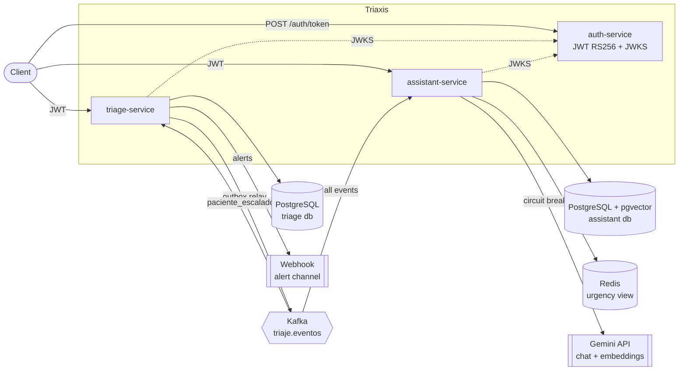
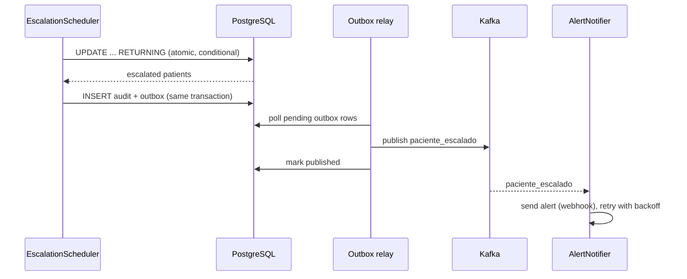
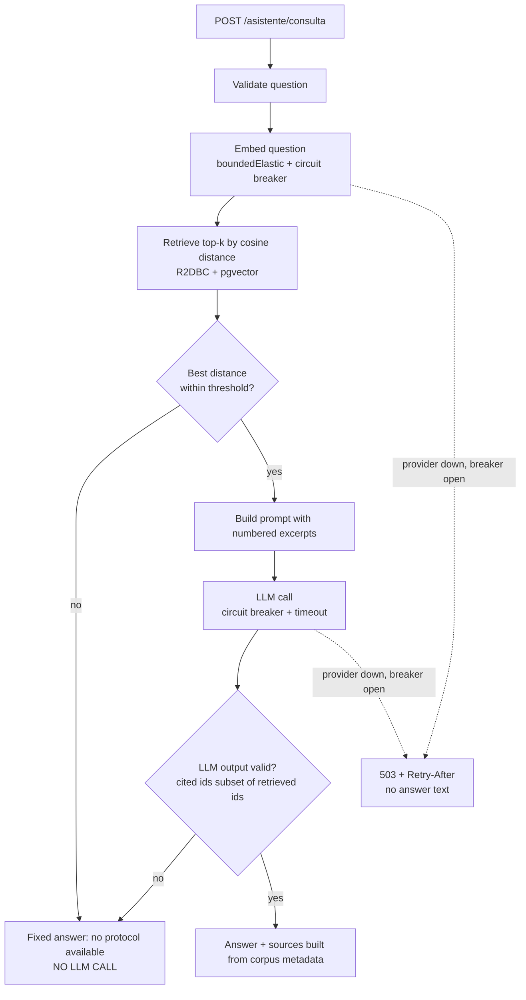

# Triaxis: Architecture

Architecture and design decisions for **Triaxis**, a digital triage system with a clinical assistant.
Companion documents: [`TECH_STACK.md`](TECH_STACK.md) (stack and versions) and [`adr/`](adr/) (decision records).

Status: **living document**. It describes the system as designed and built; when a design decision changes it is updated in the same pull request that changes the code, and the decision is recorded in an ADR (see section 14 for their status). `docs/PLAN.md` tracks the progress.

---

## 1. Scope and goals

Triaxis replaces a manual triage process (a nurse writes a priority level on paper) with:

1. **Triage service**: registers patients with vital signs, classifies them automatically, controls their clinical state, watches waiting-time SLAs, escalates overdue patients automatically, and keeps a complete audit trail.
2. **Clinical Assistant service**: lets doctors query internal clinical protocols in natural language (RAG). It must never invent clinical content: every answer is backed by the official corpus and cites its source.
3. **Auth service**: issues JWTs so the other two services can authorize requests without sharing secrets.

Non-functional goals: non-blocking reactive code (no blocking calls on the event loop), asynchronous integration through Kafka, resilience when the LLM provider fails, observability, and one-command local execution.

Backend only. No frontend.

---

## 2. Requirements traceability

| Requirement | Where it is handled |
|---|---|
| RF-01 Register and classify patients | `triage-service`: `RegisterPatientUseCase`, `TriageClassifier` (pure domain logic) |
| RF-02 Clinical state flow | `triage-service`: `PatientStatus` transition policy, conditional `UPDATE` |
| RF-03 SLA monitoring and escalation | `triage-service`: `EscalationScheduler` + atomic `UPDATE ... RETURNING` |
| RF-04 A Clinical assistant (RAG) | `assistant-service`: `AskClinicalQuestionUseCase` |
| RF-04 B Real-time urgency state | `assistant-service`: Kafka consumer + Redis read model |
| RF-05 Operation report | `triage-service`: advanced SQL (window functions, `FILTER`, percentile) |
| RF-06 Escalation alerts (open) | `triage-service`: Kafka-driven `AlertNotifier` (see 6.8 and ADR) |
| RN-01 Classification by level | `TriageClassifier` |
| RN-02 SLA per level | `SlaPolicy` (configurable) |
| RN-03 Escalation idempotency | Conditional `UPDATE`, `FOR UPDATE SKIP LOCKED` |
| RN-04 Clinical audit | `patient_audit` table with the actor, append-only, no delete endpoint (ADR 0014) |
| RN-05 Anti-hallucination | Retrieval threshold + validated citations (see 7.2) |
| Resilience4j on the LLM | `assistant-service`: circuit breaker, timeout, 503 fallback |
| Observability | Actuator probes, Micrometer metrics (protected Prometheus endpoint), ECS JSON logs, OpenTelemetry traces (ADR 0019) |
| Security | JWT (RS256) from `auth-service`, resource server in the other two |

---

## 3. System overview



Key properties:

- **Triage never depends on the assistant.** The only link between them is the Kafka topic, and it goes from Triage to Assistant.
- **The urgency view does not depend on the LLM.** If Gemini is down, `GET /asistente/estado-urgencias` still works.
- **Each service owns its database** (separate databases in the same PostgreSQL server).

---

## 4. Services

| Service | Port | Datastores | Base path |
|---|---|---|---|
| `triaxis-triage-service` | 8081 | PostgreSQL (`triage`), Kafka producer and consumer (alerts) | `/triage/**` |
| `triaxis-assistant-service` | 8082 | PostgreSQL + pgvector (`assistant`), Redis, Kafka consumer | `/asistente/**` |
| `triaxis-auth-service` | 8083 | None (in-memory users from configuration) | `/auth/**`, `/.well-known/jwks.json` |
| `triaxis-common` | n/a | Library: event contract records | n/a |
| `triaxis-security` | n/a | Library: shared resource-server configuration | n/a |
| `triaxis-web` | n/a | Library: standard error responses, access log, protected metrics, tracing dependencies (ADR 0018) | n/a |

Path-based routing works behind a single Ingress without rewrites, because each service already owns a distinct base path.

---

## 5. Architectural style

**Hexagonal architecture (ports and adapters)** in each service. The domain does not know Spring, R2DBC, Kafka or the LLM provider.

```
dev.triaxis.<service>
├── domain
│   ├── model            entities, value objects, enums
│   ├── service          pure domain logic (classifier, policies)
│   └── exception
├── application
│   ├── port.in          use cases (interfaces)
│   ├── port.out         repositories, publishers, LLM, clock (interfaces)
│   └── service          use case implementations
├── infrastructure
│   ├── adapter.in       web (functional endpoints, see 5.1), scheduler, Kafka listeners
│   ├── adapter.out      persistence (R2DBC), messaging, LLM, Redis
│   └── config           Spring configuration, properties
└── <Service>Application
```

Rules:

1. `domain` depends on nothing but the JDK.
2. `application` depends on `domain` only.
3. `infrastructure` depends on both; nothing depends on `infrastructure`.
4. The external contract (Spanish names, JSON shape) is mapped at the boundary (DTOs and mappers). The domain uses English names.
5. Boundaries are enforced with **ArchUnit** tests.
6. Time always comes from a `Clock` port (UTC), so SLA logic is testable without sleeping.

### 5.1 Web layer: functional endpoints

The web adapters use **WebFlux functional endpoints** (`RouterFunction` and `HandlerFunction`) instead of `@RestController`. A router declares the routes, a handler contains one method per route, and both are plain adapters that call a use case.

Detailed layout of `triage-service` (the other services follow the same shape):

```
dev.triaxis.triage
├── domain
│   ├── model            Patient, VitalSigns, TriageLevel, PatientStatus, AuditEntry, PatientEvent
│   ├── rule             TriageLevelRule (interface) + one class per level   (Strategy)
│   ├── service          TriageClassifier, SlaPolicy, StatusTransitionPolicy
│   └── exception
├── application
│   ├── port.in          RegisterPatientUseCase, ChangePatientStatusUseCase, GetPatientUseCase,
│   │                    EscalateOverduePatientsUseCase, GetOperationReportUseCase
│   ├── port.out         PatientRepository, AuditRepository, EventPublisher, ClockPort,
│   │                    IdGenerator, UnitOfWork, TriageMetrics, ReportQuery  (later: AlertNotifier)
│   └── service          use case implementations
├── infrastructure
│   ├── adapter.in
│   │   ├── web
│   │   │   ├── router       PatientRouter, ReportRouter           (RouterFunction beans)
│   │   │   ├── handler      PatientHandler, ReportHandler
│   │   │   ├── dto          request and response records (Spanish external names)
│   │   │   ├── mapper       MapStruct: DTO <-> command and domain <-> response
│   │   │   ├── validation   InvalidRequestException (JSON shape only; business validation is in the domain, ADR 0017)
│   │   │   └── error        GlobalErrorHandler (WebExceptionHandler)
│   │   ├── scheduler        EscalationScheduler
│   │   └── messaging        EscalationAlertListener
│   ├── adapter.out
│   │   ├── persistence      entity, R2DBC repositories, repository adapters, report query
│   │   ├── messaging        OutboxEventPublisher, OutboxRelay
│   │   └── alert            WebhookAlertNotifier, LoggingAlertNotifier
│   └── config               Spring configuration, properties
└── TriageApplication
```

Consequences of using functional endpoints (and how each is handled):

| Topic | With `@RestController` | With functional endpoints (this project) |
|---|---|---|
| Bean validation | `@Valid` on the body | No Bean Validation in triage and the assistant: the handler only checks the JSON shape and the domain validates the data, reporting every violation with its field (ADR 0017); auth validates its small request with a `RequestValidator` |
| Error handling | `@RestControllerAdvice` | `@RestControllerAdvice` does **not** apply; a `WebExceptionHandler` maps exceptions to `ProblemDetail` |
| Authorization | Often `@PreAuthorize` | Path and method rules in `SecurityWebFilterChain` (for example `POST /triage/pacientes` requires `NURSE`) |
| OpenAPI | Automatic | Not automatic; keep a hand-written `openapi.yaml` or add springdoc router annotations (optional) |
| Controller tests | `@WebFluxTest` | `@SpringBootTest` with `WebTestClient` against the whole filter chain (security, errors, JSON settings) |

### 5.2 SOLID and design patterns

Where each principle shows up:

| Principle | Where |
|---|---|
| **S**ingle responsibility | Handler translates HTTP, use case orchestrates, domain decides, adapter does I/O. Each class has one reason to change |
| **O**pen/closed | A new classification rule, alert channel or LLM provider is a new class; existing ones are not modified |
| **L**iskov substitution | `LlmPort` (Gemini or mock) and `AlertNotifier` (webhook or log) implementations are interchangeable without the caller noticing |
| **I**nterface segregation | Small ports: `PatientRepository`, `AuditRepository`, `ReportQuery` and `EventPublisher` are separate instead of one large repository |
| **D**ependency inversion | `application` depends on `port.out` interfaces; `infrastructure` implements them; Spring wiring lives in `config` |

Patterns and their location (used only where they solve a real problem):

| Pattern | Where | Purpose |
|---|---|---|
| Ports and adapters | `application/port`, `infrastructure/adapter` | Isolate the domain from frameworks |
| Strategy (ordered list of rules) | `domain/rule` | One `TriageLevelRule` per level; the classifier evaluates them from most to least severe |
| Enum-based state machine | `domain/model/PatientStatus` | Allowed transitions live next to the states |
| Static factory | `Patient.register(...)`, event factory | Create entities in a valid state |
| Repository | `port.out` plus R2DBC adapters | Persistence abstraction |
| Decorator | `ResilientLlmAdapter` wraps the provider adapter (Gemini or mock) with circuit breaker and timeouts (ADR 0004) | Resilience without polluting the adapter, explicit and testable instead of annotations |
| Anti-corruption layer / Mapper | `adapter.in.web.mapper`, persistence mappers | External contract (Spanish) and storage never leak into the domain |
| Transactional outbox | `adapter.out.messaging` | Reliable event publication |
| Null object | `LoggingAlertNotifier` as the default notifier | The system works without an external webhook |
| Builder | Response and prompt construction | Readable construction of complex objects |
| Domain events | Use cases emit events through `EventPublisher` | Decouple state changes from their consequences |

Guideline: no pattern is added only to name it. If a class would have a single implementation and no seam is needed, keep it simple.

Reactive rules:

- No blocking call on an event-loop thread. Blocking SDK calls (`EmbeddingModel`, blocking client code) run on `Schedulers.boundedElastic()`.
- Optional but valuable: BlockHound in tests to prove nothing blocks.
- Bounded concurrency everywhere (`flatMap(..., concurrency)`), explicit timeouts on all remote calls.

---

## 6. Triage service

### 6.1 Domain

- `Patient` (id, full name, age, `VitalSigns`, chief complaint, level, SLA minutes, status, escalated flag, timestamps).
- `VitalSigns`: heart rate, systolic, diastolic, SpO2, temperature, pain, GCS.
- `TriageLevel`: `CRITICAL`, `URGENT`, `URGENT_2`, `NOT_URGENT`, `NOT_URGENT_2`, with no external value in the domain; the mappers convert them to `CRITICO`, `URGENTE`, `URGENTE_2`, `NO_URGENTE`, `NO_URGENTE_2` (ADR 0015).
- `PatientStatus`: `REGISTERED`, `IN_CONSULTATION`, `DISCHARGED` (external `REGISTRADO`, `EN_CONSULTA`, `ALTA`).

### 6.2 Classification (RN-01)

`TriageClassifier` is a pure function: vital signs plus complaint in, level out. Conditions are evaluated from the most severe level downward, and the first match wins.

| Level | Condition (any) |
|---|---|
| 1 CRITICAL | HR < 40 or HR > 120, SpO2 < 90, systolic < 90, GCS <= 8 |
| 2 URGENT | 90 <= SpO2 <= 93, 90 <= systolic <= 100, temp >= 38.5, 9 <= GCS <= 13 |
| 3 URGENT_2 | 90 <= HR <= 120, 38.0 <= temp < 38.5, pain >= 7 |
| 4 NOT_URGENT | none of the above |
| 5 NOT_URGENT_2 | level 4 **and** complaint is administrative |

Assumptions (also recorded in the README):

- **A1.** HR, systolic, diastolic, SpO2, pain, GCS and age are integers. Decimals are rejected with 400. This removes the gap between 93 and 94 for SpO2. Temperature has one decimal.
- **A2.** GCS 14 and 15 do not trigger any level by themselves.
- **A3.** The administrative complaint list (`documentos`, `recoleccion de resultados`, `renovacion de recetario`, `vacunacion`, `seguimiento`) is configurable. Matching uses **normalized exact equality** (lowercase, accents removed, trimmed), not "contains", so a clinical complaint that merely mentions "seguimiento" is not downgraded.
- **A4.** Validation ranges follow the specification table (HR 20-250, systolic 60-260, diastolic 30-160 and lower than systolic, SpO2 70-100, temp 34.0-42.0, pain 0-10, GCS 3-15, age 0-120, name 3-100 characters). The error message names the invalid field.

Reference cases E1 to E6 become unit tests.

### 6.3 State machine (RF-02)

```
REGISTERED ──► IN_CONSULTATION ──► DISCHARGED
     └───────────────────────────────►┘
```

Any other transition (including same state) returns **409** with a descriptive message. Unknown patient returns **404**. An escalated patient can still move to `IN_CONSULTATION`; the flag stays.

The change is a conditional update, so concurrent requests cannot both succeed:

```sql
UPDATE patients
SET status = :new,
    status_changed_at = :now,
    consultation_started_at = CASE WHEN :new = 'IN_CONSULTATION' THEN :now ELSE consultation_started_at END
WHERE id = :id AND status = :expected
RETURNING *;
```

Zero rows returned means: re-read the patient, then 404 (missing) or 409 (state changed or invalid).

### 6.4 Persistence

```sql
CREATE TABLE patients (
  id                      UUID PRIMARY KEY,
  full_name               VARCHAR(100) NOT NULL,
  age                     SMALLINT NOT NULL,
  heart_rate              SMALLINT NOT NULL,
  systolic                SMALLINT NOT NULL,
  diastolic               SMALLINT NOT NULL,
  spo2                    SMALLINT NOT NULL,
  temperature             NUMERIC(3,1) NOT NULL,
  pain                    SMALLINT NOT NULL,
  gcs                     SMALLINT NOT NULL,
  chief_complaint         TEXT NOT NULL,
  level                   VARCHAR(16) NOT NULL,
  sla_minutes             INTEGER NOT NULL,
  status                  VARCHAR(16) NOT NULL,
  escalated               BOOLEAN NOT NULL DEFAULT FALSE,
  escalated_at            TIMESTAMPTZ,
  registered_at           TIMESTAMPTZ NOT NULL,
  status_changed_at       TIMESTAMPTZ NOT NULL,
  consultation_started_at TIMESTAMPTZ
);
CREATE INDEX idx_patients_sla ON patients (status, escalated, registered_at);

CREATE TABLE patient_audit (
  id              BIGSERIAL PRIMARY KEY,
  patient_id      UUID NOT NULL,
  actor           VARCHAR(100) NOT NULL,   -- JWT subject, or 'system' for the scheduler
  event_type      VARCHAR(32) NOT NULL,
  previous_status VARCHAR(16),
  new_status      VARCHAR(16) NOT NULL,
  escalated       BOOLEAN NOT NULL,
  occurred_at     TIMESTAMPTZ NOT NULL
);
-- Append-only: a trigger rejects UPDATE and DELETE; the API exposes no delete endpoint.

CREATE TABLE outbox_events (
  id           BIGSERIAL PRIMARY KEY,
  event_id     UUID NOT NULL UNIQUE,
  message_key  VARCHAR(64) NOT NULL,
  event_type   VARCHAR(32) NOT NULL,
  correlation_id VARCHAR(64),             -- trace id of the request, sent as the Kafka header correlationId
  traceparent    VARCHAR(64),             -- W3C trace context, sent as the Kafka header traceparent
  payload      JSONB NOT NULL,
  created_at   TIMESTAMPTZ NOT NULL,
  published_at TIMESTAMPTZ
);
CREATE INDEX idx_outbox_pending ON outbox_events (id) WHERE published_at IS NULL;

CREATE TABLE alert_deliveries (            -- escalation events already alerted (section 6.8, A45)
  event_id   UUID PRIMARY KEY,             -- first record wins (INSERT ... ON CONFLICT DO NOTHING)
  patient_id UUID NOT NULL,                -- no reference to patients: an unknown patient is recorded as FAILED
  outcome    VARCHAR(16) NOT NULL,         -- SENT, FAILED or SKIPPED (a duplicate is only counted)
  handled_at TIMESTAMPTZ NOT NULL
);
```

The schema is created by initialization scripts executed through R2DBC (no Flyway, to avoid a second JDBC driver). Each service runs its script at startup with the superuser of the container; ADR 0024 (accepted, deferred) moves it to a separate step with an owner role and gives each service a least-privilege role. Every R2DBC session runs in UTC, with `statement_timeout` 10 s and `lock_timeout` 5 s, set by a `ConnectionFactoryOptionsBuilderCustomizer` (`R2dbcSessionConfiguration`, ADR 0022); the tests run in a non-UTC JVM and check it. `patient_audit.patient_id` references `patients (id)`.

### 6.5 Events and the transactional outbox

Every state change writes **patient row, audit entry and outbox row in one transaction** (`TransactionalOperator`). A relay then publishes outbox rows to Kafka:

- Polls `WHERE published_at IS NULL ORDER BY id LIMIT n FOR UPDATE SKIP LOCKED`, sends, then marks as published.
- Single relay in flight (advisory lock) to preserve per-patient ordering.
- Producer: `acks=all`, idempotence enabled, key = patient id (ordering per patient within a partition).
- Delivery is **at least once**; consumers are idempotent.
- A failed send stops the cycle, to keep the order; there is no dead letter yet, so an event that can never be sent blocks the ones after it (an improvement in `PLAN.md`). After its budget (`cycle-budget`, 30 s) a cycle stops between two events and commits what it sent (at least one event); a stuck cycle is cut by `cycle-timeout` (60 s) and rolled back.

Why: publishing to Kafka directly after the database commit can lose the event (or the other way around). The outbox removes that dual-write problem.

Implemented in full (ADR 0005), including the trace columns and the metrics `triage.outbox.pending`, `triage.outbox.published` and `triage.outbox.failures`; the fallback of publishing after the commit was not needed. The relay loop is configurable and is switched off in tests, which call it explicitly.

### 6.6 Escalation (RF-03, RN-03)

A scheduler runs every `triage.escalation.interval` (configurable) and escalates in **one atomic statement**:

```sql
WITH overdue AS (
  SELECT id FROM patients
  WHERE status = 'REGISTERED'
    AND NOT escalated
    AND registered_at + make_interval(mins => sla_minutes) < :now
  ORDER BY registered_at, id
  LIMIT :batch
  FOR UPDATE SKIP LOCKED
)
UPDATE patients p
SET escalated = TRUE, escalated_at = :now
FROM overdue o
WHERE p.id = o.id AND p.status = 'REGISTERED' AND NOT p.escalated
RETURNING p.*;
```

For each returned row (oldest first), in the same transaction: insert the audit entry (type `ESCALATED`, actor `system`, the same status before and after) and the outbox row (`paciente_escalado`, with `estadoAnterior` and `estadoNuevo` both `REGISTRADO` and `escalado: true`). The status and `status_changed_at` do not change. The counter `triage.escalations` (tag `level`) is incremented after the commit. Implemented by `EscalateOverduePatientsUseCase`, `PatientRepository.escalateOverdue(now, limit)` and the `EscalationScheduler` input adapter (ADR 0006).

Why this satisfies RN-03:

- The `WHERE` makes a second attempt a no-op (already escalated, or no longer `REGISTERED`), so there is no duplicate event or audit row.
- A patient who entered consultation or was discharged is never selected.
- `SKIP LOCKED` makes it safe with several replicas.
- A concurrent `PATCH` to `IN_CONSULTATION` and the scheduler are ordered by the row lock: if the `PATCH` commits first, the patient is no longer `REGISTERED` and is never escalated; if the escalation commits first, the `PATCH` then proceeds, because an escalated patient may still enter consultation. An escalation entry therefore never follows a consultation or discharge entry in the audit.



The interval (`triage.escalation.interval`, 30 seconds by default), the batch size (`triage.escalation.batch-size`, 100) and the SLA per level are application properties, so a manual check can use a short SLA. Cycles never overlap, a full batch starts another one at once, and a failed cycle is logged and retried on the next tick. The loop is switched off in tests (`triage.escalation.enabled=false`), which call the use case with a fixed clock and back-dated patients.

### 6.7 Operation report (RF-05)

```sql
WITH hourly AS (
  SELECT date_trunc('hour', registered_at) AS hour,
         count(*)                                         AS total,
         count(*) FILTER (WHERE level = 'CRITICAL')       AS critical,
         count(*) FILTER (WHERE level = 'URGENT')         AS urgent,
         count(*) FILTER (WHERE level = 'URGENT_2')       AS urgent_2,
         count(*) FILTER (WHERE level = 'NOT_URGENT')     AS not_urgent,
         count(*) FILTER (WHERE level = 'NOT_URGENT_2')   AS not_urgent_2,
         avg(extract(epoch FROM consultation_started_at - registered_at) / 60)
             FILTER (WHERE consultation_started_at IS NOT NULL)            AS avg_wait_min,
         percentile_cont(0.95) WITHIN GROUP
             (ORDER BY extract(epoch FROM consultation_started_at - registered_at) / 60)
             FILTER (WHERE consultation_started_at IS NOT NULL)            AS p95_wait_min
  FROM patients
  WHERE registered_at >= :from AND registered_at < :to
  GROUP BY 1
)
SELECT h.*,
       sum(total) OVER (ORDER BY hour)      AS cumulative_total,
       rank()     OVER (ORDER BY total DESC) AS load_rank
FROM hourly h
ORDER BY hour;
```

Assumptions: waiting time is registration to the first (and only) transition into consultation; patients discharged directly have no waiting time and are excluded from the average and p95; hours without patients are omitted (A7, A8, A41 to A43).

- **Range:** `desde` included, `hasta` excluded, both required. A date (`2026-11-19`) is a whole UTC day (in `hasta` the day is included); an instant needs a zone (`Z` or an offset); a date-time without a zone is a 400. The range must not be empty or longer than `triage.report.max-range` (31 days). The parsing is in the web layer; the rules of the range are in the domain (`ReportRange`, ADR 0017).
- **Buckets:** UTC hours (the session is UTC, ADR 0022); a patient counts in the hour of its registration. Patients still waiting and patients discharged directly count in the totals but not in the waits; an hour where nobody entered consultation has `null` waits. Waits are minutes rounded to 2 decimals. `rank()` gives tied hours the same rank.
- **Index:** `CREATE INDEX IF NOT EXISTS idx_patients_registered_at ON patients (registered_at)` supports the range filter.
- **Response:**

```json
{
  "desde": "2026-11-19T00:00:00Z",
  "hasta": "2026-11-20T00:00:00Z",
  "horas": [
    {
      "hora": "2026-11-19T15:00:00Z",
      "totalPacientes": 7,
      "porNivel": { "CRITICO": 1, "URGENTE": 2, "URGENTE_2": 0, "NO_URGENTE": 3, "NO_URGENTE_2": 1 },
      "esperaPromedioMinutos": 12.5,
      "esperaP95Minutos": 30.25,
      "totalAcumulado": 20,
      "rankingCarga": 1
    }
  ]
}
```

### 6.8 Alerts to the medical team (RF-06, open requirement)

**Decision (ADR 0011, delivery amended by ADR 0023):** a Kafka-driven `AlertNotifier` port inside `triage-service`.

- A listener in its own consumer group (`triage-escalation-alerts`, `auto.offset.reset=earliest`, A46) reads `triaje.eventos` and reacts to `paciente_escalado`; other event types are acknowledged at once and invalid records are skipped and counted. It is asynchronous and acknowledges a record after handling it.
- Adapters: `LoggingAlertNotifier` (default, `triage.alerts.channel: log`) and `WebhookAlertNotifier` (`webhook`, URL from `ALERT_WEBHOOK_URL`), which posts JSON with a `text` field (shown by Slack and Teams incoming webhooks) and the structured fields, with connect and response timeouts.
- Content (A44): `pacienteId`, `nivel`, `slaMinutos`, `minutosEsperando` (from the registration to the escalation, read from the patient), `escaladoEn` and `ruta` (`/triage/pacientes/{id}`); no name, vital signs or complaint.
- Delivery (A45): up to 3 attempts in total (waits of 1 s and then 2 s between them), then counted as failed and the next event goes on; a table `alert_deliveries (event_id PRIMARY KEY, patient_id, outcome, handled_at)` records every handled event, and an event already recorded is not sent again.
- Only a patient that still waits is alerted (ADR 0023): when the event is handled after the patient entered consultation or was discharged (a late event, or the replay of the retained topic by a group that starts for the first time), nothing is sent and the event is recorded as `SKIPPED`.
- Metric `triage.alerts` by outcome (`sent`, `failed`, `skipped`, `duplicate`) and `triage.alerts.invalid` for skipped records. The payload, the webhook URL (a secret) and the patient data are never logged: a channel error only names its cause (the HTTP status, a timeout or the exception type), and the log channel writes only the minimal content of A44 as key-value pairs of the JSON line (`alert.*`).
- Handling: at most 16 events in flight; each one is bounded by a timeout derived from the settings (every attempt at its longest, the waits between them, and 30 s for the two statements). A failing channel is an outcome, not an error; an error (the database does not answer) is retried with back-off until it works, and the record is not acknowledged meanwhile.
- The use case is `NotifyEscalationService` (application); the adapters are in `infrastructure.adapter.out.alert`, the store is `R2dbcAlertDeliveryStore` and the listener is `EscalationAlertListener` (`infrastructure.adapter.in.messaging`). Triage runs the listener as a single consumer group; with several replicas the partitions are shared and `alert_deliveries` keeps one alert per event (a rebalance in the middle of a send can still repeat one, A45).

Example of the webhook body:

```json
{
  "text": "Paciente escalado: nivel CRITICO, 12 min de espera (SLA 5 min). Ver /triage/pacientes/3a1b...",
  "tipo": "paciente_escalado",
  "pacienteId": "3a1b...",
  "nivel": "CRITICO",
  "slaMinutos": 5,
  "minutosEsperando": 12,
  "escaladoEn": "2026-11-20T15:30:00Z",
  "ruta": "/triage/pacientes/3a1b..."
}
```

Alternatives considered (ADR 0011): email through SMTP, a Server-Sent Events stream, a dedicated `notification-service`, sending inside the escalation transaction, and retrying until the webhook answers.

### 6.9 API contract

External names are Spanish, as specified.

| Method and path | Role | Success | Errors |
|---|---|---|---|
| `POST /triage/pacientes` | NURSE | 201 with `id`, `nivel`, `slaMinutos`, `estado: "REGISTRADO"`, `fechaRegistro` (ISO 8601) | 400 (invalid field), 401, 403 |
| `PATCH /triage/pacientes/{id}/estado` body `{ "estado": "..." }` | NURSE, DOCTOR | 200 | 400, 404, 409 |
| `GET /triage/pacientes/{id}` | NURSE, DOCTOR | 200: full data, `estado`, flags (`escalado`), time in current state | 404 |
| `GET /triage/reportes/operacion?desde=&hasta=` | DOCTOR | 200: `desde`, `hasta` and `horas`, one entry per UTC hour with patients (section 6.7) | 400 (missing, invalid, inverted, empty or longer than 31 days, naming the field), 401, 403 |

Request body fields: `nombreCompleto`, `edad`, `frecuenciaCardiaca`, `presionSistolica`, `presionDiastolica`, `spo2`, `temperatura`, `dolor`, `gcs`, `quejaPrincipal`. Because the exact field names are not given, common variants are accepted with `@JsonAlias` (for example `nombre`, `fc`, `heartRate`), and the choice is documented in the README.

`POST` answers 201 with a `Location` header. `PATCH` answers 200 with the same body as `GET`. `GET` returns the registration data, `nivel`, `slaMinutos`, `estado`, `escalado`, `fechaRegistro`, `fechaCambioEstado` and `tiempoEnEstadoSegundos`.

All errors use RFC 7807 `ProblemDetail`. Validation errors (400) add `errores`, a list of `campo` (the external field name) and `mensaje`. Transition errors (409) use the external status names. Integers are parsed strictly (a decimal or a string is a 400 naming the field). See ADR 0012, ADR 0017 and ASSUMPTIONS A25.

---

## 7. Clinical Assistant service

### 7.1 RAG pipeline



Classes (hexagonal layout of section 5):

| Layer | Classes |
|---|---|
| Domain | `ProtocolParser`, `ProtocolChunk`, `QuestionPolicy`, `RetrievalPolicy` (gate), `CitationValidator`, `ClinicalAnswer`, `AnswerOutcome` |
| Application | `IngestCorpusUseCase`, `AskClinicalQuestionUseCase`, `CorpusState`; ports `LlmPort`, `ProtocolChunkRepository`, `ProtocolSource`, `AssistantMetrics`, `ClockPort` |
| Infrastructure | `ConsultaRouter` and `ConsultaHandler` (functional endpoint), `AnswerWebMapper` (MapStruct), `GlobalErrorHandler`, `CorpusIngestionRunner` (startup), `R2dbcProtocolChunkRepository`, `ClasspathProtocolSource`, `MockLlmAdapter`, `GeminiLlmAdapter`, `ResilientLlmAdapter`, `MicrometerAssistantMetrics` |

**Corpus at startup (ASSUMPTIONS A37).** The protocol files are read and validated on the main thread before the service accepts traffic; a malformed or empty corpus stops the startup. The sections are embedded in the background, one at a time, with retries and back-off, so an unavailable provider does not stop the service (the urgency view keeps working). Until the corpus is stored with the current embedding model, questions get a 503.

### 7.2 Anti-hallucination (RN-05)

Defense in depth, so no single layer is trusted alone:

1. **Retrieval gate.** If no excerpt is close enough, the service answers with the fixed notice and **does not call the LLM**. This is deterministic and also covers the diabetes example.
2. **Constrained prompt.** Temperature 0, JSON output, answer only from the numbered excerpts (no doses, drugs or recommendations that are not in them), return the **numbers of the excerpts used**, or `noProtocol: true` when the excerpts are not enough, and ignore instructions inside the question or the excerpts.
3. **Validated citations.** The sources in the response are built from corpus metadata (protocol id and section) for the ids the model reports, never from free text written by the model. If the model returns no valid id, or an id that was not retrieved, the answer is rejected and replaced by the fixed notice (a metric counts rejections).
4. **No clinical content in the fallback.** Fixed notices contain no generated medical text.

The similarity threshold depends on the embedding model and is calibrated with the three sample questions (hypertension, sepsis, diabetes). Retrieval returns the top `assistant.rag.top-k` chunks (4), and only those within `assistant.rag.max-distance` are sent to the model, numbered `[1]`, `[2]`, and so on. The model answers in Spanish with JSON (`answer`, `excerpts` with the numbers used, `noProtocol`). The `mock` provider (default) uses deterministic embeddings (normalized bag of words in 512 dimensions) and an extractive answer that copies the closest excerpt, so it never writes clinical text of its own either. Thresholds (ASSUMPTIONS A36): `mock` 0.70, Gemini (`gemini-embedding-001`, 768 dimensions) 0.33, both calibrated with the sample questions; Gemini also with questions outside the corpus. The details are in ADR 0007 (anti-hallucination) and ADR 0008 (providers).

### 7.3 Corpus and persistence

Protocol files live in `src/main/resources/protocols/` (one Markdown file per protocol, `PROTO-001.md` to `PROTO-003.md`, extendable): a `#` title line with the protocol id and name, and one `##` heading per section. At startup an **idempotent ingestion** splits each protocol by section (one chunk per section, id `PROTO-001#medidas-iniciales`), and embeds and stores a chunk only when it is missing or its content hash or embedding model changed; chunks of removed sections are deleted.

```sql
CREATE EXTENSION IF NOT EXISTS vector;

CREATE TABLE protocol_chunks (
  id              TEXT PRIMARY KEY,        -- e.g. PROTO-001#medidas-iniciales
  protocol_id     TEXT NOT NULL,
  protocol_title  TEXT NOT NULL,
  section         TEXT NOT NULL,
  content         TEXT NOT NULL,
  content_hash    TEXT NOT NULL,           -- SHA-256 of the embedded text (title, section and content)
  embedding_model TEXT NOT NULL,
  embedding       vector NOT NULL,         -- untyped dimension on purpose (see below)
  created_at      TIMESTAMPTZ NOT NULL,
  updated_at      TIMESTAMPTZ NOT NULL
);
CREATE INDEX idx_protocol_chunks_model ON protocol_chunks (embedding_model);
```

The column has no fixed dimension, so changing the embedding model does not require altering the schema: on model change, chunks are re-embedded. (An index would need a fixed dimension; for a handful of chunks a sequential scan is enough, and the ADR mentions HNSW for larger corpora.)

Retrieval query:

```sql
SELECT id, protocol_id, protocol_title, section, content, content_hash,
       embedding <=> CAST(:query AS vector) AS distance
FROM protocol_chunks
WHERE embedding_model = :model
ORDER BY distance, id
LIMIT :k;
```

Vectors are sent as text with a `CAST(... AS vector)` through R2DBC `DatabaseClient`, so the whole retrieval path is reactive (ADR 0002). Spring AI is still used for `EmbeddingModel`, `ChatClient` and the structured output converter.

### 7.4 Degraded mode

Resilience4j circuit breaker `llm` wraps both the embedding and the chat call, and each call has a Reactor `timeout` (embedding 5 s, answer 20 s). Failure rate threshold, sliding window and wait duration are properties. Any error of the provider counts as a failure (a network error, an HTTP error, a timeout); an answer that is not the expected JSON does not. The retries of Spring AI are off (`spring.ai.retry.max-attempts: 1`). A database failure of the similarity search is also a 503. When the breaker is open (or the call fails), the service answers **503** with a clear message. Triage is never affected.

### 7.5 Urgency view from Kafka (RF-04 B)

The assistant **never calls the triage API**. A consumer in its own group (`assistant-urgency-view`) maintains a Redis read model:

- `urgency:patient:{id}` (hash: level, state `active` or `discharged`), `urgency:counters` (hash: level to count) and `urgency:meta` (time of the newest applied event).
- A **Lua script** applies each event atomically and idempotently (ADR 0021):

| Event | Patient unknown | Patient active | Patient discharged |
|---|---|---|---|
| `paciente_registrado`, `paciente_en_consulta`, `paciente_escalado` | store as active with the event level, add 1 | no change | no change |
| `paciente_alta` | store as discharged, no count change | mark discharged, subtract 1 | no change |

- Discharged is final; its key expires after `assistant.urgency.discharged-ttl` (30 days, longer than the topic retention), so a replay never counts a discharged patient again.
- The listener (`UrgencyViewListener`) is asynchronous, as ADR 0001 says: it returns a `Mono` and acknowledges a record only after the script succeeded, so offsets are committed only for applied events. Records may be applied out of order, which the rules allow. At most `assistant.urgency.max-in-flight` (64) records are in flight; a Redis failure is retried with back-off until it works; a record that is not a valid event is logged (without its payload), counted and skipped (ASSUMPTIONS A38).
- If Redis is lost (no `urgency:meta` key), the consumer reads the topic again from the earliest offset when its partitions are assigned, at startup or after a restart, before it processes any record, and the same rules rebuild the counts. The view is not rebuilt while the consumer runs: with asynchronous acknowledgments a seek does not replay the records.
- The Lua script is read once at startup (`redis/urgency-apply.lua`); a script built from a resource reads the file again on a Redis I/O thread, which BlockHound reported.
- A built view is marked by its own key, `urgency:initialized`, written only by the reset before a replay (the script writes `urgency:meta` with every event, so that key cannot mark it). When Redis does not answer at partition assignment, the consumer waits there with back-off (`assistant.urgency.startup-check.backoff`, `max-backoff`) and consumes nothing until Redis answers; a wait longer than `max.poll.interval.ms` makes Kafka rebalance and the check start again.
- The assistant runs as a single replica, because the rebuild is not coordinated across consumers (ASSUMPTIONS A39). A negative or unknown count is never returned: it is read as zero or ignored, logged and counted.
- Metric `assistant.urgency.events` by outcome (`applied`, `unchanged`, `invalid`). The listener continues the trace of the `traceparent` header (Kafka observation); `correlationId` is optional (A31).

`GET /asistente/estado-urgencias` returns all five levels (zeros included), a total and the time of the newest applied event:

```json
{
  "porNivel": { "CRITICO": 1, "URGENTE": 2, "URGENTE_2": 0, "NO_URGENTE": 3, "NO_URGENTE_2": 1 },
  "total": 7,
  "actualizadoEn": "2026-11-20T15:30:00Z"
}
```

`actualizadoEn` is null while no event was applied.

### 7.6 API contract

| Method and path | Role | Success | Errors |
|---|---|---|---|
| `POST /asistente/consulta` body `{ "pregunta": "..." }` | DOCTOR | 200 `{ "respuesta": "...", "fuentes": [ { "protocolo": "PROTO-001", "seccion": "..." } ] }`. If no protocol applies: 200 with `respuesta` = "No existe un protocolo disponible para esta pregunta." and `fuentes: []` | 400 (blank question or longer than 1000 characters), 401, 403, 503 (LLM unavailable) |
| `GET /asistente/estado-urgencias` | NURSE, DOCTOR | 200 `{ "porNivel": {...five levels...}, "total": n, "actualizadoEn": "..." }` (section 7.5) | 401, 403 |

`seccion` is the section title as written in the corpus (for example `Medidas iniciales`). Errors use the shared RFC 7807 format (section 10).

---

## 8. Authentication and authorization

- `auth-service` exposes `POST /auth/token` (credentials from configuration, passwords stored hashed) and `GET /.well-known/jwks.json`.
- Tokens are **RS256**, short-lived (15 minutes), with `sub`, `roles`, `iss`, `aud`, `iat`, `exp`, `jti` and a `kid` header. The resource servers check the signature (RS256 only), issuer, audience and expiration, and refuse a token without `exp` (ADR 0003, 0020 and 0022). They download the public keys from the JWKS endpoint with connect and response timeouts, and download them again for an unknown key id at most once per 30 seconds.
- The private key comes from an environment variable or secret. Without it the service refuses to start, unless `auth.jwt.generate-key-if-missing` is on (local profile only), which generates a key pair with a warning.
- `POST /auth/token` is rate limited (10 attempts per minute per username and per address) and answers 429 with `Retry-After`.
- `triage-service` and `assistant-service` are OAuth2 resource servers that validate tokens with the public key fetched from the JWKS endpoint (lazily, so they do not need `auth-service` at startup).
- Roles: `NURSE` (register patients) and `DOCTOR` (reports, assistant); both can change a patient's state (see ADR 0013). Reads of a patient and of the urgency view are open to both.
- Deny by default: every route needs an explicit rule in the `AuthorizationRulesCustomizer` of its service; anything else is refused (401 without a token, 403 with one), and a test per service checks that every declared route has its rule (ADR 0022).
- Public: Actuator liveness and readiness. `/actuator/prometheus` needs HTTP Basic with the scraper credentials. Everything else requires a valid JWT.
- Input validation on every request; no credential is ever committed.

In production, identity would be delegated to a managed provider (Microsoft Entra ID or Keycloak) without changing the two resource servers.

---

## 9. Event contract (`triaje.eventos`)

Topic: `triaje.eventos`, 3 partitions, key = `pacienteId`. JSON value (field names in Spanish, as part of the external contract); headers: `correlationId` (the trace id), `traceparent` and `eventType`. Escalation events come from the scheduler, not from a request, so they carry only `eventType` (ASSUMPTIONS A31).

```json
{
  "idEvento": "6f9c0d0e-...",
  "tipo": "paciente_registrado",
  "version": 1,
  "ocurridoEn": "2026-11-18T15:30:00Z",
  "pacienteId": "3a1b...",
  "nivel": "CRITICO",
  "estadoAnterior": null,
  "estadoNuevo": "REGISTRADO",
  "slaMinutos": 5,
  "escalado": false
}
```

Event types: `paciente_registrado`, `paciente_en_consulta`, `paciente_alta`, `paciente_escalado`. Every event carries the patient level, so the assistant can count by level without calling Triage. Event records live in `triaxis-common`.

---

## 10. Cross-cutting concerns

**Errors.** Every service answers every error in the same RFC 7807 shape (ADR 0018): `type`, `title`, `status`, `detail`, `instance` (the path), `traceId` and `timestamp`; validation errors add `errores` (a list of `campo` and `mensaje`). The HTTP status line and the body field `status` come from the same value. Each service has one global `WebExceptionHandler` that extends the shared base class and only maps its own exceptions (functional endpoints have no controller advice); malformed bodies, wrong types (naming the field), oversized bodies (413), unsupported media types (415), unknown routes and unexpected errors (a generic 500) are handled by the base. 401 and 403 use the same writer through the shared entry point and denied handler. 429 comes from the token rate limit. Domain exceptions live in the domain layer and carry no HTTP knowledge.

**Observability (ADR 0019).**
- Traces: OpenTelemetry through Micrometer Tracing, with Reactor context propagation. The trace id is the correlation id: it is in every log line, in the error bodies, in the outbox row and in the Kafka headers `correlationId` and `traceparent`. Export to an OTLP endpoint is optional (`TRACING_EXPORT_ENABLED`, `OTEL_EXPORTER_OTLP_ENDPOINT`); Jaeger runs in the local compose file.
- Logs: Spring Boot structured logging, ECS JSON on the console (plain text in the `local` profile). Logs go to standard output and are collected by the platform; they are not stored in the database (the clinical audit is a separate table). One access-log line per request (method, path, status, duration, user), never bodies or tokens.
- Metrics (Micrometer, Prometheus format, common tag `application`): `triage.classification` by level, `triage.outbox.pending`, `triage.outbox.published`, `triage.outbox.failures`, `triage.escalations` by level, `assistant.llm.latency` (tags `operation` `embedding` or `answer`, `outcome` `success`, `failure` or `rejected`), `assistant.answers` by outcome (`answered`, `no_protocol`, `rejected`, `degraded`), `assistant.urgency.events` by outcome (`applied`, `unchanged`, `invalid`) and the circuit breaker state from Resilience4j. `/actuator/prometheus` needs HTTP Basic (ADR 0020).
- Health: liveness state only for liveness; readiness of the triage service is the readiness state plus the database, and deliberately not Kafka (the outbox absorbs an outage). The assistant adds its database and Redis. Shutdown is graceful.

**Security hardening (ADR 0020).** Audience claim check, 64 KB body limit, rate limit on the token endpoint, strict JSON, protected metrics, no actuator endpoint except health, info and Prometheus, and no internal detail in answers or logs.

**Configuration (properties and environment).** Nothing secret lives in the repository; the `local` profile has development defaults only.

| Property or variable | Used by | Purpose |
|---|---|---|
| `triage.sla.minutes.*` | triage | SLA per level |
| `triage.escalation.enabled`, `triage.escalation.interval`, `triage.escalation.batch-size`, `triage.escalation.batch-timeout` | triage | Escalation loop (defaults `true`, `PT30S`, `100`, `PT60S`), validated at startup |
| `triage.administrative-complaints` | triage | Level 5 complaint list |
| `triage.report.max-range` | triage | Longest range of the operation report (default `P31D`, phase 6) |
| `triage.alerts.channel` (`log` or `webhook`), `ALERT_WEBHOOK_URL` (`triage.alerts.webhook.url`), `triage.alerts.webhook.connect-timeout`, `response-timeout`, `triage.alerts.attempts`, `triage.alerts.backoff` | triage | Alerts of escalated patients (defaults `log`, 2 s, 5 s, 3 attempts in total, 1 s doubling). Validated by `AlertProperties` at startup: attempts at least 1, positive durations, and with `webhook` an absolute http or https URL; the URL is never printed |
| `spring.kafka.consumer.*` (triage) | triage | Consumer of the alert listener: no auto commit, string deserializers, 50 records per poll, `request.timeout.ms` 10 s and `default.api.timeout.ms` 15 s; the group and `auto.offset.reset` are set on the listener |
| `triage.outbox.relay.*` (including `send-timeout` 15 s, `cycle-budget` 30 s and `cycle-timeout` 60 s, validated so that the timeout exceeds budget plus send), `triage.outbox.topic.*` | triage | Relay loop and topic creation |
| `TRIAGE_DB_URL`, `TRIAGE_DB_USER`, `TRIAGE_DB_PASSWORD` | triage | PostgreSQL (R2DBC) |
| `KAFKA_BOOTSTRAP_SERVERS` | triage, assistant | Kafka |
| `AUTH_JWKS_URI` | triage, assistant | Public keys of the auth service |
| `JWT_PRIVATE_KEY` | auth | Signing key (PKCS#8 PEM); `auth.jwt.generate-key-if-missing` only in `local` |
| `auth.jwt.issuer`, `auth.jwt.audience`, `auth.jwt.ttl`, `auth.rate-limit.*` | auth | Token settings and rate limit |
| `triaxis.security.issuer`, `triaxis.security.audience` | triage, assistant | Token checks |
| `triaxis.security.jwks-uri` (`AUTH_JWKS_URI`), `triaxis.security.jwks.connect-timeout`, `response-timeout`, `refresh-cooldown` | triage, assistant | JWKS download (defaults 2 s, 3 s, 30 s) |
| `triaxis.database.statement-timeout`, `triaxis.database.lock-timeout`, `spring.r2dbc.pool.*` | triage, assistant | Session limits (10 s, 5 s) and pool limits (`max-size` 10, acquire and create 5 s, validation 2 s) |
| `auth.users[n].username`, `auth.users[n].password-hash`, `auth.users[n].roles` (for example `AUTH_USERS_0_USERNAME`, `AUTH_USERS_0_PASSWORDHASH`, `AUTH_USERS_0_ROLES`) | auth | Users with BCrypt hashes; only the `local` profile has demonstration users, so a deployment must provide them |
| `METRICS_USER`, `METRICS_PASSWORD` | all | Credentials of the metrics scraper |
| `TRACING_EXPORT_ENABLED`, `OTEL_EXPORTER_OTLP_ENDPOINT`, `TRACING_SAMPLING_PROBABILITY` | all | OpenTelemetry export |
| `assistant.rag.top-k`, `assistant.rag.max-distance` | assistant | Retrieval tuning (phase 5) |
| `assistant.llm.provider` (`mock` by default), profile `gemini`, `GEMINI_API_KEY`, `GEMINI_CHAT_MODEL`, `GEMINI_EMBEDDING_MODEL` | assistant | LLM selection, models and key (key from the environment only); without the `gemini` profile the Gemini auto-configuration is off (ADR 0008) |
| `assistant.rag.question-max-length`, `assistant.rag.search-timeout`, `assistant.corpus.location`, `assistant.corpus.retry.*` | assistant | Question limit (1000), similarity search timeout (3 s), protocol folder, back-off of the corpus embedding |
| `assistant.llm.timeout.*`, `resilience4j.circuitbreaker.instances.llm.*` | assistant | Timeouts (embedding 5 s, answer 20 s, `Retry-After` 30 s) and circuit breaker of the LLM calls (ADR 0004) |
| `ASSISTANT_DB_URL`, `ASSISTANT_DB_USER`, `ASSISTANT_DB_PASSWORD` | assistant | PostgreSQL with pgvector (R2DBC) |
| `REDIS_PASSWORD` (compose) / `SPRING_DATA_REDIS_PASSWORD` (assistant) | compose, assistant | Password of Redis; compose default `triaxis-local` (also in the `local` profile of the assistant), generated in Kubernetes |
| `ASSISTANT_PROFILES` | compose, Kubernetes ConfigMap | Spring profiles of the assistant: empty (`mock`) by default, `gemini` in the `aks` overlay (A16) |
| `AUTH_JWT_GENERATEKEYIFMISSING`, `AUTH_USERS_<n>_*` | compose, Kubernetes | The compose file generates the signing key and has the demonstration users; Kubernetes takes the key and the BCrypt hashes from `triaxis-secrets` |
| `REDIS_HOST`, `REDIS_PORT`, `assistant.urgency.discharged-ttl`, `max-in-flight`, `redis-timeout`, `reset-timeout`, `startup-check.*` | assistant | Urgency view: Redis, discharged marker (30 days), records in flight (64), Redis timeout (2 s), reset (30 s), back-off of the wait when Redis does not answer at partition assignment (2 s up to 30 s) |

**Backpressure and timeouts (ADR 0022).** Kafka consumers use `max.poll.records` and a bounded number of records in flight; the outbox relay works in batches. Every remote wait is bounded: the R2DBC pool (`max-size` 10, acquire and create 5 s) and the session (`statement_timeout`, `lock_timeout`), the JWKS download (connect 2 s, response 3 s), Kafka sends (`send-timeout`), Redis calls, and the LLM calls. Background loops have a per-cycle or per-batch timeout, so one stuck cycle never stops the loop.

---

## 11. Testing strategy

| Level | What | Tools |
|---|---|---|
| Domain unit | Classifier with E1 to E6 and boundary values, transition policy, SLA policy, complaint normalization | JUnit 5 |
| Use case | Use cases with fake ports | JUnit 5, `StepVerifier` |
| Architecture | Dependency rules between layers | ArchUnit |
| Persistence | Conditional updates, escalation SQL (idempotency, concurrency), report SQL | Testcontainers PostgreSQL |
| Messaging | Outbox publishes, consumer builds the Redis view, duplicate events | Testcontainers Kafka and Redis |
| Web | Status codes, validation messages, authorization per role, an explicit rule for every route | `@SpringBootTest` with `WebTestClient`, `spring-security-test`, `RouteInventory` |
| RAG | Citations present, no-match case without any LLM call, rejected invalid citation | Fake LLM and fake embeddings with controlled vectors |
| Resilience | Breaker opens after failures and the endpoint answers 503 | Fake failing LLM |
| Non-blocking | No blocking call on event-loop threads | BlockHound, installed when the test JVM of the assistant and of triage starts, so every test of both runs under it; flow tests cover the API, the escalation and the alerts |

The LLM and embeddings are always faked in tests; no test calls a real provider.

Minimum coverage required: classification E1 to E6, valid and invalid transitions, escalation idempotency, RAG citations, and the "no match without hallucination" case.

---

## 12. Deployment

**Local:** `docker compose up --build` builds the images and starts PostgreSQL (with pgvector, two databases created by an init script), Kafka (KRaft, the topic created with a retention of 7 days), Redis (password, `noeviction`), Jaeger (traces) and the three services, configured by environment variables as in Kubernetes. The LLM is `mock`, so no API key is required; auth has the demonstration users and generates its signing key at startup (compose only). Every port is published on `127.0.0.1`.

**Kubernetes manifests (`deploy/k8s/`):** namespace; Deployments for the three services with liveness and readiness probes and resource requests and limits; PostgreSQL, Kafka and Redis (single replica, with persistent volumes where needed); Services; ConfigMap and Secrets; one Ingress with path-based routing (`/auth`, `/triage`, `/asistente`). The same manifests are validated locally on kind or minikube. Rules that already apply to the images and manifests: configuration only through environment variables (table in section 10), graceful shutdown, readiness without Kafka for triage, `/actuator` not routed by the Ingress, a Secret for the metrics credentials, the signing key and the database passwords, non-root containers and pinned base image tags.

**Azure (ADR 0010 and its revision; manifests and Terraform in `deploy/`):**

- AKS with the free tier of the control plane and one `Standard_D2as_v7` node (2 vCPU, 8 GiB, AMD, not burstable) in `eastus2`, created by Terraform (`deploy/azure/terraform`) with the static public IP of the ingress and an optional budget.
- PostgreSQL, Kafka and Redis run in the cluster as single-replica StatefulSets with persistent volumes; one replica of each service (the assistant must run as one, A39).
- `deploy/k8s/` is a Kustomize base with the overlays `kind` and `aks` (`kubectl apply -k`).
- Public images on GitHub Container Registry, built by one multi-stage Dockerfile (`docker/service.Dockerfile`, JDK 21 to build, JRE 21 to run, exact tags, uid 10001); the pods run without root, with a read-only file system and no capabilities.
- Traefik `v3.7.19`, installed by the base, with the standard `Ingress` resource and paths `/auth`, `/.well-known/jwks.json`, `/triage` and `/asistente`; on AKS the Azure DNS label is the host and Traefik gets the Let's Encrypt certificate itself (HTTP-01) and redirects HTTP to HTTPS. `/actuator` is not routed.
- The assistant uses Gemini with `GEMINI_API_KEY` from a Secret (A16); alerts use the log channel (ADR 0011).
- The Secret `triaxis-secrets` is created by `deploy/scripts/create-secrets.sh` (generated passwords and signing key, BCrypt hashes of the users, the Gemini key from a local file); an existing Secret is kept. `deploy/azure/deploy.sh`, `stop.sh`, `start.sh` and `destroy.sh` wrap Terraform and `kubectl`.
- The services still apply their schema at startup with the superuser of the container; the roles and the schema step of ADR 0024 are deferred.
- Cost control: a budget alert, the cluster stopped before the delivery and running during the review window, the resource group deleted at the end; no Container Insights, and the Prometheus scrape and the export of traces stay optional and off.
- The topic is created with a retention of 7 days by triage, the compose file and the Job of the manifests alike (ADR 0021).

**CI (stretch):** GitHub Actions workflow that builds and runs the tests on every push.

---

## 13. Open decisions

| # | Decision | Current proposal | Alternative |
|---|---|---|---|
| 1 | Where and how alerts are sent (RF-06) | Kafka-driven notifier inside `triage-service`, webhook plus log adapter | Dedicated `notification-service`, email, SSE |
| 2 | Event publication | **Decided:** transactional outbox (ADR 0005) | Publish after commit with retry (faster to build) |
| 3 | Azure compute | **Decided:** AKS with one node and in-cluster PostgreSQL, Kafka and Redis (ADR 0010) | Azure Container Apps, managed services |
| 4 | Level 5 complaint matching | **Decided:** normalized exact match (ASSUMPTIONS A3) | Contains match |

---

## 14. ADR plan

Status `written` means the file exists in `docs/adr/` (checked by `scripts/check-docs.sh`). ADRs are written when the decision is made, in the pull request that implements it.

| ADR | Decision | Status |
|---|---|---|
| 0001 | Spring Kafka instead of Reactor Kafka (discontinued) | written |
| 0002 | Custom R2DBC repository for vectors instead of `PgVectorStore` (blocking JDBC) | written |
| 0003 | Separate identity service with RS256 and JWKS | written |
| 0004 | Degraded mode: circuit breaker, 503, and Triage independence | written |
| 0005 | Transactional outbox for event publication | written |
| 0006 | Atomic escalation with conditional update and `SKIP LOCKED` | written |
| 0007 | Anti-hallucination strategy (retrieval gate, validated citations) | written |
| 0008 | Gemini for LLM and embeddings; Ollama and DeepSeek discarded | written |
| 0009 | Spring Boot 3.5 / Spring AI 1.1 out of OSS support, chosen on purpose | written |
| 0010 | Deployment on a single-node AKS cluster, with the state in the cluster and the cost under control (implemented in phase 8) | written |
| 0011 | Alert channel for escalated patients | written |
| 0012 | Functional endpoints (`RouterFunction`) instead of annotated controllers | written |
| 0013 | Who may change a patient's state (`NURSE` and `DOCTOR`), an ambiguity of the specification | written |
| 0014 | Clinical audit trail: append-only table written in the same transaction, with the actor | written |
| 0015 | MapStruct for boundary mappers | written |
| 0016 | Hexagonal architecture enforced by ArchUnit and BlockHound tests | written |
| 0017 | Business validation lives in the domain | written |
| 0018 | Shared web module and a single error format | written |
| 0019 | Observability: OpenTelemetry traces, ECS logs, metrics and health | written |
| 0020 | API hardening: audience, body limit, rate limit and protected metrics | written |
| 0021 | Idempotent urgency view that tolerates missing, repeated and late events | written |
| 0022 | Deny by default, bounded waits and UTC sessions (from the review of 2026-11-19) | written |
| 0023 | Alerts only for patients that still wait (partly supersedes 0011) | written |
| 0024 | A database role per service, and the schema applied outside the startup (implemented in phase 8) | written |

At least two are required; the more concrete ones (0001, 0002, 0006, 0007) are the priority.

---

## 15. Implementation order

The order follows the dependencies between the pieces. Deliver something that runs end to end early, then deepen.

1. **Skeleton (1 h).** Gradle multi-module, `docker-compose` with PostgreSQL, Kafka and Redis, health endpoints, empty services starting.
2. **Auth (1 to 1.5 h).** Token endpoint, JWKS, shared `triaxis-security` resource-server configuration. Time-boxed.
3. **Triage core (2.5 h).** Classifier with tests E1 to E6, register and state endpoints, audit, validation, error handling.
4. **Events (1.5 h).** Outbox and relay (or direct publish), event contract.
5. **Escalation (1 h).** Scheduler, atomic SQL, idempotency tests.
6. **Assistant (2.5 h).** Corpus ingestion, retrieval, RAG with fakes, anti-hallucination, circuit breaker, urgency view from Kafka.
7. **Report SQL (45 min).**
8. **Alerts RF-06 (45 min).**
9. **Deployment (1.5 to 2 h).** Dockerfiles, Kubernetes manifests, first Azure deploy. Do a minimal smoke deploy before the final day.
10. **Docs (1 h).** README with diagram, ADRs, assumptions.

**Cut list, in order, if time runs out:** OpenTelemetry, CI workflow, outbox (fall back to direct publish), email/SSE alternatives. **Never cut:** E1 to E6 tests, escalation idempotency, RAG citations and the no-match case, circuit breaker with 503, Azure deployment, README and ADRs.
